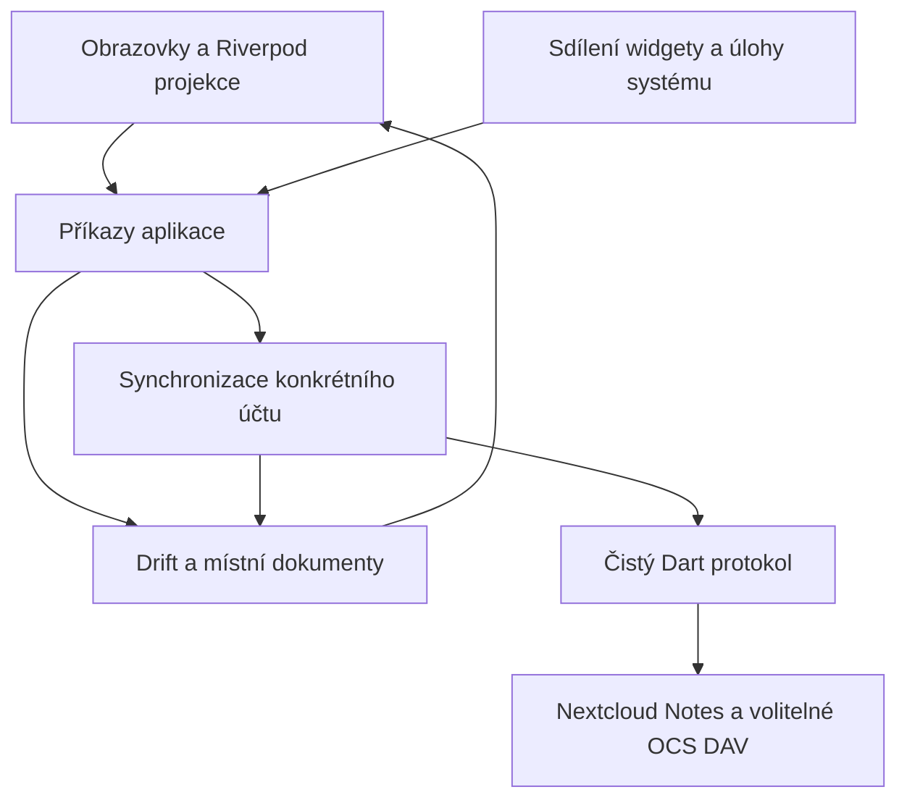
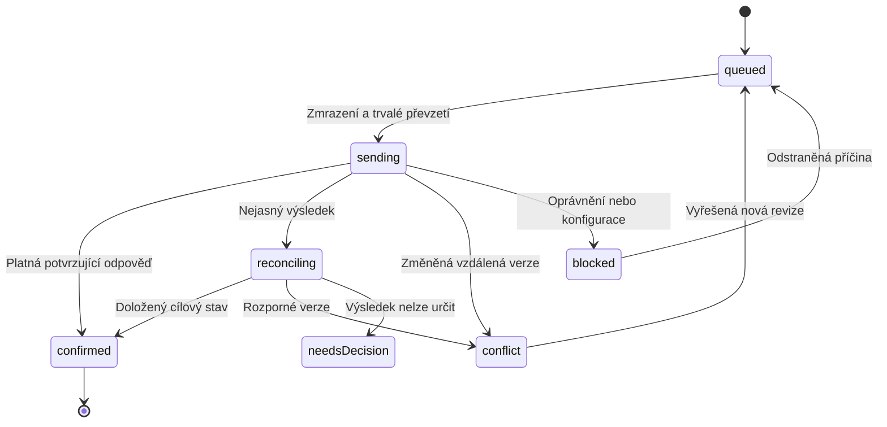

# Nextcloud Notes — analýza a plán vlastní Flutter implementace

**Datum:** 18. 10. 2026 · **Revize:** 1 · **Stav:** přípravný návrh před implementací.

## 1. Doporučený směr

Postavit samostatnou Flutter aplikaci pro Android a iOS, která používá existující Nextcloud Notes a jeho soubory. Uživatelské chování odvodit z mobilních klientů, protokol ověřovat proti backendu a synchronizaci implementovat jako vlastní, oddělenou část aplikace.

Z Owntalk převzít způsob práce i ověřené principy: dohledatelný katalog funkcí, přesné API kontrakty, oddělení účtů, lokální databázi jako zdroj dat pro rozhraní, trvalou frontu operací a průkazné podmínky dokončení jednotlivých etap. Přenos konkrétního kódu vyžaduje kontrolu závislostí; synchronizační pravidla Talku nejsou pravidly Notes. [O1], [O2], [O3], [O4]

### Hlavní rozhodnutí návrhu

1. **Backend ponechat standardní.** První použitelná verze nepotřebuje vlastní PHP aplikaci, databázi na serveru ani prostřední službu.
2. **Samostatné přihlášení přes Login Flow v2.** Instalace Nextcloud Files nebude podmínkou fungování.
3. **Původní Markdown bude kanonický obsah.** Editor a náhled nesmějí při otevření nebo uložení přepsat neznámé formátování.
4. **Zápis nejdřív lokálně, potom synchronizace.** Drift/SQLite uchovává poznámky, rozpracované změny, vzdálené výchozí verze i frontu.
5. **Vlastní malý klient Notes API.** JSON těla požadavků, přesné zpracování hlaviček, částečných odpovědí a chyb; závislost na velkém SDK zde nepřináší dostatečnou úsporu.
6. **Nevydávat nejasný výsledek za úspěch či neúspěch.** Ztracená odpověď po vytvoření poznámky může znamenat, že už na serveru vznikla. Automatické opakování by mohlo vyrobit duplikát.
7. **Nevytvářet dojem absolutní ochrany souběhu.** `If-Match` je nutný, ale audit Notes vrstvy nepotvrdil atomickou kontrolu a zápis. `DELETE` podmínku verze vůbec nekontroluje. [B2], [B3], [B4]

### Pracovní předpoklady

- První vydání: Android a iOS, telefon i tablet/skládací zařízení. Windows, macOS a Linux mají připravené hranice architektury, samostatné vydání následuje až po mobilní stabilizaci.
- Více účtů i více serverů v jedné instalaci.
- Vlastní název a identita aplikace; název ani balíčky Owntalk se nepřebírají.
- Pro plnohodnotné úpravy požadovat Notes API alespoň 1.2. Starší API nezapínat tichým přepnutím na nechráněné zápisy.
- Funkce API 1.4, především přílohy, zapínat podle zjištěných schopností konkrétního serveru.
- Obnova dat, práce bez připojení a věrnost textu mají přednost před rozsáhlým formátovacím rozhraním.

Tyto předpoklady umožňují začít s protokolem a testy bez rozhodování o finálním názvu, ikoně nebo obchodech s aplikacemi.

## 2. Rozsah a pevné podklady

### 2.1 Prohlédnuté verze

| Komponenta | Základ analýzy | Pevný bod |
| --- | --- | --- |
| Nextcloud Notes backend | Stabilní **6.1.0**, vydání 15. 9. 2026 | `0c3dd46dbd781b780c1ea60a13873198609bb98d` |
| Notes backend, vývoj | `main`, stav z 17. 10. 2026 | `5801abe7f21a4721daa53793cf2cec2cb357c212` |
| Android Notes | Stabilní **35.0.0**, vydání 16. 9. 2026 | `0be81b4331946b850dd7397f9a5453c063bf69d3` |
| Android Notes, vývoj | `main`, stav z 18. 10. 2026 | `d5cf5fee6610ac457c87e88144086d4ce715a181` |
| iOS Notes | Stabilní **35.0.0**, vydání 19. 9. 2026 | `9b693b2073f4a927a31c63ddb737ec74253ea404` |
| iOS Notes, vývoj | Podrobný rozbor `main`, stav z 16. 10. 2026 | `4829e126c69db174b73b593c7c3fd805ba112b97` |
| Dart SDK | Publikovaný balíček `nextcloud` **9.0.0**; zvlášť audit aktuálního generovaného klienta | `provokateurin/nextcloud.dart`: `b28536dd2c252320a87f22617e93aa32c178a6ff` |
| Neon | Referenční existující Flutter implementace Notes | `3d7512f45eb4c7a272b0f60e3853eecd5d9b1210` |
| Owntalk | Aktuální dokumentace, bootstrap a závislosti | `029b6d138533d8c0186193561203d3168a0ea0eb` |
| Notes starší profil | Stabilní **6.0.2**, vydání 17. 8. 2026; porovnání příloh | `d2916b499c3c72e323b1a0db6191661178d683a6` |

Repozitáře a zdroje jsou v oddílu 19. Verze aplikace, verze Nextcloudu a verze Notes API jsou tři různé údaje. Například Notes 6.1.0 poskytuje API řady 1.x a běží nad samostatně verzovaným Nextcloud Serverem. [B1], [B6], [A1], [I1], [F1]

Backendové `lib`, API dokumentace, API testy a routy jsou mezi uvedeným stabilním vydáním a prohlédnutým `main` shodné. Android má mimo aktualizace závislostí, verzí a překladů také změnu sdílení textu z otevřeného editoru; tato změna není součástí stabilního 35.0.0. Podrobná iOS zjištění se vztahují k uvedenému `main`, pokud není výslovně uvedeno jinak. [A13]

### 2.2 Co tato analýza ověřuje

Ověřené jsou zdrojové implementace, routy, datové modely, existující testy, dokumentované protokoly a návaznosti. Byly porovnány konkrétní serverové i klientské cesty, nikoli pouze seznamy funkcí v README. [B2], [B3], [B4], [B5], [B18], [B19], [A2], [A3], [A4], [A5], [I1], [I2], [I3], [I4]

**Nebyly spuštěny mobilní aplikace na zařízení ani integrační testy proti konkrétní uživatelově instanci.** Tvrzení o riziku vycházející ze statického kódu proto nejsou vydávána za reprodukovanou chybu. Výkonové limity, testovací matice a odhady práce níže jsou návrh. Tento dokument není dokladem hotové Flutter aplikace.

### 2.3 Kompatibilita serveru

Notes 6.1.0 deklaruje v `appinfo/info.xml` **Nextcloud 33–36 a PHP 8.2–8.5**. Deklarace zahrnuje i vývojovou řadu; dokumentace Nextcloudu při analýze označovala 35 jako latest, 33/34 jako stable a 36 jako upcoming. [B6], [N1]

Navržená ověřovací matice:

| Profil | Použití |
| --- | --- |
| Nextcloud 35 + Notes 6.1.0 | Hlavní referenční prostředí |
| Nextcloud 34 + odpovídající podporované Notes | Druhá povinná integrační řada |
| Nextcloud 33 + odpovídající podporované Notes | Nejstarší řada pro kandidáta veřejného vydání |
| Nextcloud 36 | Průběžná kompatibilita, dokud není stabilní, bez příslibu produkční podpory |
| Notes API 1.2/1.3 bez příloh 1.4 | Ověření vypnutých funkcí a základního protokolu |

Podporovaná matice se má zveřejnit podle skutečně úspěšných testů. Nemá automaticky vzniknout převzetím rozsahu z XML nebo tvrzení knihovny.

## 3. Co převzít z Owntalk

| Oblast | Využitelné | Hranice přenosu |
| --- | --- | --- |
| Struktura projektu | Flutter aplikace a malý samostatně testovatelný Dart protokol | Nevytvářet balíček pro každou obrazovku |
| Účty | Kanonická serverová URL, náhodné lokální `accountId`, bezpečné úložiště přihlašovacích údajů | Účet se neidentifikuje pouze uživatelským jménem |
| Bootstrap | Login Flow v2, ověření adres, veřejné a přihlášené capabilities | Odstranit předpoklady o Talk capabilities, push a místnostech |
| Databáze | Drift/SQLite jako zdroj dat pro UI | Schéma Notes navrhnout samostatně |
| Stav UI | Riverpod jako projekce a koordinace | Nekopírovat obsah poznámek do druhé konkurenční databáze v providerech |
| Fronta | Trvalé operace, zmrazený odesílaný obsah, explicitní nejistý výsledek | Identifikátory zpráv ani potvrzení Talku neřeší idempotenci Notes POST |
| Rozhraní | Adaptivní seznam/detail, systémové zpět, dostupnost | Poznámka je dokument, nikoli chatová zpráva |
| Dokumentace | Funkce → požadavek → kontrakt → test → důkaz dokončení | Pouhá existence kódu není důkaz funkce na zařízení |

Současný Owntalk používá mimo jiné `http`, Drift a `flutter_riverpod`; z paměti se nemá přebírat starší doporučená verze knihovny proti aktuálnímu lockfilu. V nové aplikaci připnout konkrétní kompatibilní verze až po krátkém ověření překladů Android/iOS. [O1], [O2], [O3], [O4]

## 4. Jak funguje backend

### 4.1 Autorita dat a soubory

Obsah poznámek tvoří běžné soubory v uživatelově Nextcloudu. Notes k nim přidává REST API, metadata, kategorie a webové rozhraní. Soubor tak může změnit webové Notes, mobilní Notes, Files, WebDAV klient i desktopová synchronizace. To je základní důvod, proč klient musí počítat s úpravami mimo vlastní aplikaci. [B5], [B7]

| Hodnota | Význam pro klienta |
| --- | --- |
| `id` | Identita vzdáleného souboru; ukládat pod konkrétním účtem, nikoli globálně |
| `title` | Název svázaný s názvem souboru; server jej může upravit kvůli znakům nebo kolizi |
| `category` | Relativní složka; `Práce/Projekt` představuje vnořené kategorie; `""` znamená bez kategorie |
| `content` | Původní text, typicky Markdown |
| `favorite` | Uživatelský příznak využívající serverové značky |
| `modified` | Unixový čas změny; lze jej poslat klientem, není to spolehlivá verze dokumentu |
| `readonly` | Zákaz úprav obsahu a metadat s výjimkou oblíbenosti |
| `etag` | Verze Notes objektu vypočtená z obsahu a vybraných atributů |

`notes_meta` je pomocná tabulka pro detekci změn a synchronizaci, nikoli úložiště samotného textu. Backend kombinuje události souborů, souborový ETag a hash obsahu; `modified` nemusí změnu spolehlivě popsat. [B5], [B8]

Název souboru není stabilní identita. Přejmenování, přesun do kategorie ani změna přípony nemají v klientovi vytvořit novou lokální poznámku jen proto, že se změnila cesta. Při operacích Files/WebDAV se musí skutečné zachování ID ověřit odpovědí nebo následným načtením.

### 4.2 Veřejné a další rozhraní

Základ Notes API:

```text
{nextcloudBaseUrl}/index.php/apps/notes/api/v1
```

`nextcloudBaseUrl` může obsahovat podadresář. Nepřepisovat jej vždy na kořen domény.

| Rozhraní | Operace | Použití |
| --- | --- | --- |
| Notes REST | `GET /notes` | Seznam, synchronizace a konečný seznam živých ID |
| Notes REST | `GET /notes/{id}` | Detail a ověření vzdáleného stavu |
| Notes REST | `POST /notes` | Vytvoření; vrací 200 a serverové ID |
| Notes REST | `PUT /notes/{id}` | Částečná změna atributů; posílat `If-Match` |
| Notes REST | `DELETE /notes/{id}` | Smazání; bez podmíněného porovnání verze |
| Notes REST | `GET`, `PUT /settings` | Nastavení účtu v Notes |
| Notes REST 1.4 | `GET`, `POST`, `DELETE /attachment/{noteid}` | Čtení, nahrání a odstranění přílohy |
| Nextcloud Login Flow | `/index.php/login/v2` a serverem vrácený poll endpoint | Získání samostatného hesla aplikace |
| Nextcloud OCS | Capabilities a uživatelská identita | Zjištění schopností a DAV UID |
| Files Sharing OCS | Sdílení a vyhledání příjemců | Samostatné rozšíření klienta |
| Files templates OCS + WebDAV | Seznam šablon a jejich obsah | Šablony nejsou samostatná Notes REST kolekce |
| WebDAV versions | Historie a obnova verzí souboru | Samostatná funkce podle dostupnosti serveru |
| Files direct editing | Serverový editor | Volitelné online rozšíření |

Notes odpovědi nejsou zabalené do OCS obálky. OCS obálku parsovat pouze na OCS rozhraních. Úspěch obecného HTTP 200 se musí vyhodnotit podle správného protokolu a očekávaného těla. [B2], [B3], [B9], [N2], [N3], [N4]

**Pozor na verze v URL:** backend 6.1.0 inzeruje `0.2`, `1.3` a `1.4`, ale CRUD routy mají stále `/api/v1/notes`. `/api/v1.4/notes` není odpovídající CRUD cesta. Alias `v1.4` mají přílohy a čtení nastavení. Volba nejvyšší capability tedy nesmí mechanicky změnit společný základ URL. [B3], [B10]

Navíc **Notes 6.0.2 již také inzeruje API 1.4**, ačkoliv dnešní tabulka API jeho zavedení připisuje 6.1. Samotné číslo capability tedy nedokládá všechny přílohové funkce. [B16]

| Přílohový profil | GET/POST | DELETE | Výsledek uploadu |
| --- | --- | --- | --- |
| Notes 6.0.2 | Jen `/api/v1.4/attachment/{id}` | Nedostupné | Plochý náhodný název v kategorii |
| Notes 6.1.0 | `/api/v1.4/attachment/{id}` a alias `/api/v1/attachment/{id}` | Dostupné pro vlastní přílohovou složku | Relativní cesta do `.attachments.{id}` |

Pro společné GET/POST použít kompatibilní `/api/v1.4/attachment/{id}`. Mazání povolit pouze ve známém ověřeném profilu, například 6.1.0; neprovádět destruktivní zkušební DELETE nad uživatelskými soubory. U neznámé verze nezaměnit „API 1.4“ za důkaz mazání či konkrétního uložení. Cestu vždy určit z odpovědi. Profil je odvozen z verze Notes aplikace a ověřeného kontraktu, nikoli z čísla Nextcloud Serveru.

### 4.3 Tři různé ETag

1. **Notes ETag poznámky:** JSON `etag`, podklad pro `If-Match` při PUT.
2. **ETag odpovědi seznamu:** vypočtený z konkrétního seznamového těla; váže se na parametry požadavku a stránku.
3. **WebDAV/souborový ETag:** metadata souborového rozhraní. Nesmí se zaměnit za Notes ETag.

Notes ETag zahrnuje ID, title, modified, category, favorite, readonly a hash obsahu. Nezahrnuje všechny další údaje, například `isShared`, `shareTypes`, `internalPath`, obsah příloh a příznak chyby načtení. Obnovení informací o sdílení a přílohách proto nesmí záviset výhradně na změně tohoto ETag. [B8]

V JSON je ETag bez HTTP uvozovek. `Helper::getNoteWithETagCheck()` při porovnání očekává položku s uvozovkami. Serializace tedy vytvoří například `If-Match: "abc123"`, právě jednou. Nenahrazovat to `If-Match: *` ani neposílat JSON řetězec jako neuzavřený HTTP tag. [B4]

### 4.4 Omezení zápisů

| Zjištění v backendu | Důsledek návrhu |
| --- | --- |
| Kontrola `If-Match` předchází několika samostatným změnám | Nelze z Notes vrstvy odvodit atomické compare-and-swap celého objektu |
| `PUT` mění obsah, čas, jméno/kategorii a oblíbenost postupně | Chyba pozdější části nemusí vrátit dříve uložený obsah |
| `DELETE` nevolá ETag kontrolu | Samotná hlavička u DELETE nezajistí ochranu před souběžnou změnou |
| `POST` nemá idempotency key ani klientské ID | Ztracená odpověď neumožní bezpečné automatické opakování vytvoření |
| Konflikt `412` obsahuje aktuální vzdálenou poznámku | Uložit ji jako vstup řešení konfliktu, nepřepsat jí rozpracovaný text |
| Backend opakuje některé zamčené operace | `423` nebo následný `5xx` nepovažovat za důkaz nulového zápisu |

To neznamená, že každá současná dvojice požadavků musí skončit ztrátou změny. Znamená to, že silnou garanci nelze doložit samotným kontrolovaným Notes kódem. Přesný souběh musí ověřit test se zpožděním mezi kontrolou verze a zápisem v konkrétní serverové sestavě. [B2], [B4], [B11]

### 4.5 Nastavení mění rozsah synchronizace

Veřejná dokumentace popisuje především `notesPath` a `fileSuffix`. Zdroj navíc vrací `noteMode`, `showHidden` a `loadRecentOnStartUp`. Výchozí přípona v aktuálním zdroji je `.md`, zatímco starší text API stále uvádí `.txt`; klient má používat skutečnou odpověď, nikoli natvrdo převzatý výchozí údaj. [B9]

Změna `notesPath`, pravidel viditelnosti, suffixu nebo přístupu ke sdílené složce může způsobit, že poznámka zmizí ze seznamu, ačkoliv její soubor nebyl smazán. Proto oddělit:

- **Vzdáleně smazáno či nedostupné:** zjištěný stav vzdálené identity.
- **Mimo aktuální rozsah Notes:** změna složky, viditelnosti nebo podporovaného souboru.
- **Lokálně smazáno:** uživatelova čekající operace.

Při změně rozsahu založit novou generaci synchronizace, zahodit předchozí průchod a kurzor, zachovat rozpracované dokumenty a obnovitelné kopie. Změna serverového nastavení ovlivňuje i ostatní klienty uživatele; v rozhraní ji oddělit od místního vzhledu aplikace.

### 4.6 Chybový obsah není poznámka

`Note::getData()` může při chybě čtení vrátit `error: true` a do `content` vložit text chyby. Takový obsah se nesmí stát novou platnou vzdálenou verzí, přepsat cache nebo následně odejít na server jako uživatelův text. Zachovat poslední validní kopii a zobrazit stav nedostupnosti konkrétní poznámky. [B5]

## 5. Synchronizace seznamu a detekce změn

### 5.1 Co opravdu znamená `pruneBefore`

Nejde o proud událostí typu „změněno/smazáno“. Nezměněné poznámky mohou přijít pouze jako `{"id": 123}`. Tento záznam znamená existenci poznámky, nikoli prázdný obsah, výchozí kategorii nebo `favorite=false`.

Používat čas z HTTP `Last-Modified` předchozího dokončeného průchodu. Nepoužívat čas telefonu ani maximum `modified` z poznámek. Backend filtruje podle vlastního času aktualizace metadat; souborové `modified` je jiná veličina. Přesnost je v sekundách a podmínka prune je striktní `<`, proto neodstraňovat překryv přičtením jedné sekundy. [B2], [B4], [B8]

Chybějící nebo neplatný `Last-Modified` nesmí vytvořit odhadnutý watermark. Při zpětném serverovém čase zneplatnit dosavadní časový základ a provést úplný průchod bez prune; teprve jeho validní serverový čas se může stát novým základem. Do vyřešení uchovat poslední platná data a neoznačovat časovou synchronizaci za dokončenou.

### 5.2 Stránkování

`chunkSize` omezuje počet plných poznámek, nikoli celkový počet objektů nebo výslednou velikost poslední odpovědi. Všechny stránky mají HTTP 200. Další stránku určuje `X-Notes-Chunk-Cursor`; tento řetězec klient uchovává jako neprůhlednou hodnotu.

**Teprve poslední odpověď bez kurzoru obsahuje i všechny živé ID v daném rozsahu.** Právě její aktuální ID použít k vyhodnocení nepřítomnosti. Sjednocení ID starších stránek by mohlo nechat živou poznámku, která byla mezitím odstraněna. Naopak absence v průběžné stránce neznamená nic o smazání. [B2], [B4], [B12]

Každá stránka znovu načítá aktuální stav. Kurzor s časem začátku není zmrazený databázový snapshot. Opakované ID a změny v průběhu průchodu musí klient zvládnout bez zdvojení a s následným dorovnáním.

### 5.3 Navržený průchod

1. Načíst lokální data a ihned vykreslit UI.
2. Založit průchod v rozsahu `(accountId, accountGeneration, settingsEpoch, queryScope)`.
3. Pro celkovou synchronizaci nepoužívat filtr `category`. Serverový filtr má přesnou shodu; nezahrnuje podkategorie. Hierarchické filtrování seznamu zajistí místní dotaz.
4. Zahájit `GET /notes` s posledním potvrzeným watermarkem, zvoleným `chunkSize` a bez starého kurzoru.
5. Ověřit status, hlavičky, JSON, typy položek a příznaky chyb. Rozlišit plný objekt, projekci bez obsahu a pouze ID.
6. Platné plné poznámky ukládat přes slučování vzdálených a lokálních změn. Nikdy nepřepsat čekající lokální edit pouze proto, že dorazil GET.
7. Při dalším kurzoru pokračovat se stejnými parametry a rozsahem. Detekovat opakující se kurzor, nepřiměřený počet stran a překročení velikostních limitů.
8. Z poslední stránky získat úplný seznam aktuálně viditelných ID. Neznámé ID bez těla samostatně dočíst; nedoplňovat ho prázdnou poznámkou.
9. Před dokončením znovu načíst relevantní serverová nastavení a porovnat rozsah se začátkem průchodu. Při změně jej neuzavřít. Samotná lokální settingsEpoch neodhalí změnu provedenou mezitím ve webu. V transakci dokončení vyhodnotit nepřítomné čisté položky, ochránit lokální změny, uzavřít průchod a uložit nový watermark z `Last-Modified` téhož průchodu; backend při stránkování zachovává čas jeho začátku.
10. Při pozorovaném souběhu nebo neúplných tělech zopakovat dorovnání. Po pádu aplikace je bezpečnější zahájit nový průchod od posledního dokončeného watermarku než vydávat nedokončené stránky za úplný snapshot.

Stránky lze postupně promítat do UI, ale **oprávnění odstraňovat položky a posunout globální synchronizační bod vzniká až při dokončení**. Průchod se změněným účtem, nastavením, poškozeným JSON, transportní chybou nebo nepoužitelnými poznámkami nesmí skončit jako „vše synchronizováno“.

`304 Not Modified` není prázdný seznam. Lze jej použít jen s existující platnou cache přesně dané reprezentace. ETag cache musí obsahovat identitu účtu, epochu a parametry požadavku; zejména nemíchat první stránku, poslední stránku, filtr kategorie a různé hodnoty `exclude`/`pruneBefore`.

Pro první implementaci doporučuji optimalizaci přes seznamový `If-None-Match` při stránkování vypnout. Pruning a dávky přinesou úsporu i bez této další vrstvy. Podmíněný GET jednotlivé poznámky a pozdější zapnutí seznamové cache mají vlastní kontraktní testy.

### 5.4 Pravidla nepřítomnosti

| Lokální stav | Poznámka chybí v dokončeném aktuálním seznamu |
| --- | --- |
| Čistá synchronizovaná kopie | Označit vzdáleně nedostupnou, vyřadit z běžného seznamu; dočasně ponechat obnovitelná data |
| Rozpracovaná změna | Vytvořit konflikt úprava proti nedostupnosti; zachovat text |
| Nová poznámka bez serverového ID | Seznam se jí netýká |
| Vytváření s nejasným výsledkem | Zachovat původní operaci a spustit její ověření; nevyrobit další POST |
| Čekající lokální mazání | Vyhodnotit stav této operace; nemíchat se změnou rozsahu nebo oprávnění |
| Rozsah Notes se změnil | Nejprve dokončit novou generaci; starý seznam není podklad k promazání |

### 5.5 Výkonové omezení backendu

Menší odpověď neznamená menší serverovou práci. `getNotesAndCategories()` nejprve získá všechny poznámky a metadata, následně filtruje a rozděluje odpověď. Poslední stránka navíc obsahuje všechna ID. Při N poznámkách a P stránkách je třeba počítat s opakovaným průchodem kolekcí; přesnou cenu určuje úložiště, cache a změny obsahu. [B4], [B8]

Návrh: rozumný počet větších dávek, jeden aktivní průchod na účet, žádné agresivní dotazování všech účtů každou sekundu. Hodnotu `chunkSize` určit měřením na referenční instanci; počáteční kandidát je 100–250 plných poznámek. Jde o pracovní parametr, nikoli naměřené optimum.

## 6. Mobilní aplikace a cílová parita

### 6.1 Android

Oficiální Android klient používá nativní obrazovky, Room, synchronizační úlohy a Nextcloud Single Sign On. Nextcloud Files používá pro přihlášení a síťové SSO. Má více účtů, místní cache a rozpracované poznámky pro přidaný účet, kategorie, oblíbené, Markdown, vyhledávání, hromadné akce, widgety, zamykání aplikace, sdílení i cestu do serverového editoru. Samostatný režim bez účtu není v prohlédnutých cestách doložen. Stabilní 35.0.0 má Android minSdk 28 a targetSdk 36; to není automaticky minimum nové Flutter aplikace. [A1], [A2], [A3], [A4], [A5], [A6], [A7], [A8], [A9], [A11]

Podstatné odlišnosti, které nepřevzít:

- `NotesAPI_1_0` při PUT neposílá `If-Match`.
- Synchronizační postup nejprve odesílá změny a potom načítá vzdálený stav.
- Komentář o optimistickém řešení konfliktu chrání místní stav při souběžné editaci na stejném zařízení. Nezajišťuje porovnání vzdálené verze mezi klienty.
- Po `404` při úpravě může znovu vytvořit poznámku, čímž uživatelský úmysl smazání na jiném zařízení nemusí zůstat zachován.
- Přepnutí oblíbenosti používá odlišnou přímou síťovou cestu a odesílá celý objekt; není rovnocenné trvalé místní frontě editací.
- Pro `readonly` jsou v prohlédnutých cestách mezery při kopírování a aktualizaci metadat. Gson a Room umějí pole načíst; nelze tvrdit, že se nikdy nenaplní. Ochranu editoru po změně oprávnění musí prokázat integrační scénář.

To jsou důvody navrhnout vlastní synchronizační model. Otevřené i uzavřené issues slouží jako podnět k testům; samotný stav „closed“ není důkaz opravy. [A2], [A3], [A4], [A5], [A10]

### 6.2 iOS

Aktuální `nextcloud/notes-ios` kombinuje starší implementaci a novější SwiftUI vrstvu. Prohlédnutý zdroj obsahuje Core Data příznaky `addNeeded`, `updateNeeded`, `deleteNeeded`; pořadí synchronizace je odstranění, přidání, úpravy a stažení. Datové struktury sice obsahují seznam účtů, ale aktuální `Store.reloadAccounts()` výslovně udržuje jediný aktivní účet kvůli historickému modelu persistence. [I1], [I2], [I3], [I4]

Ani tato fronta není vhodný vzor k mechanickému přenosu: aktualizační cesta nepoužívá `If-Match` a po některých odpovědích nepřítomnosti znovu vytváří poznámku. Nová Flutter aplikace proto přidá plnohodnotnou izolaci více účtů a společný synchronizační model obou platforem.

Minimum hlavní iOS aplikace v analyzovaném zdroji je 17.0. Vyšší číslo 26.0 u testovacího targetu není minimum aplikace. Je to informace o referenčním klientovi, nikoli automatický požadavek nové Flutter aplikace. [I5]

### 6.3 Katalog cílových funkcí

Priority: **P0** = základ bezpečné použitelné aplikace; **P1** = další parita; **P2** = samostatné rozšíření. Označení P0 neznamená, že funkce je již implementovaná.

| ID | Funkce | Cílové chování | Priorita |
| --- | --- | --- | --- |
| F-01 | Přidání serveru | Podadresář, ověření adresy, srozumitelná chyba | P0 |
| F-02 | Přihlášení | Systémový prohlížeč, Login Flow v2, 2FA na serveru | P0 |
| F-03 | Více účtů | Oddělené relace, cache, fronty a synchronizace | P0 |
| F-04 | Odpojení účtu | Upozornění na místní změny, bezpečné odstranění dat | P0 |
| F-05 | Seznam poznámek | Okamžitě z cache, výřezy textu, stav změn; přepnutí seznam/mřížka | P0 |
| F-06 | Řazení | Datum, název, oblíbené; preference místní | P0 |
| F-07 | Kategorie | Vnořená struktura, bez kategorie, přesun poznámky | P0 |
| F-08 | Přejmenování kategorie | Zachovat vnořené cesty, zvládnout částečné selhání | P1 |
| F-09 | Oblíbené | Okamžitá místní změna i bez sítě, stejná fronta | P0 |
| F-10 | Hledání | Název i obsah místně, vysvětlení neúplné cache | P0 |
| F-11 | Hledání uvnitř | Zvýraznění shod, další/předchozí výskyt | P0 |
| F-12 | Vytvoření | Místní UUID, samostatný název, bezpečné přidělení serverového ID | P0 |
| F-13 | Automatický návrh názvu | Pouze při vzniku, nezměnit ručně zadaný název | P0 |
| F-14 | Přejmenování | Přijmout normalizovaný serverový výsledek | P0 |
| F-15 | Textový editor | Původní Markdown, navazování seznamů, odsazování, IME; obnova kurzoru a scrollu | P0 |
| F-16 | Náhled | Markdown a existující obrázky, vlastní URL policy, režim po poznámce | P0 |
| F-17 | Formátovací lišta | Nadpisy, důraz, seznamy, citace, odkazy, kód | P0 |
| F-18 | Zaškrtávací seznamy | Ovládání v náhledu mění správný znak zdrojového textu | P0 |
| F-19 | Vrátit/zopakovat editaci | Konzistentní undo/redo v editoru | P0 |
| F-20 | Ukládání | Potvrdit místní uložení až po transakci; síť odděleně | P0 |
| F-21 | Práce bez sítě | Čtení stažených poznámek, vytváření a změny | P0 |
| F-22 | Konflikty | Zachovat základ, místní a vzdálenou verzi | P0 |
| F-23 | Nejasný výsledek | Ověření vytvoření/zápisu; přehledná obnova | P0 |
| F-24 | Smazání | Fronta, krátké zpět před odesláním, obnovitelná kopie | P0 |
| F-25 | Hromadné akce | Smazání se zpět a změna kategorie; výsledky jednotlivých poznámek | P1 |
| F-26 | Pouze ke čtení | Zakázat edit, ponechat povolenou oblíbenost | P0 |
| F-27 | Externí změny | Web, Files, jiný telefon, desktopové soubory | P0 |
| F-28 | Ruční obnova | Plynulé načtení a zobrazení důvodu problému | P0 |
| F-29 | Stav synchronizace | Lokálně uloženo, čeká, odesílá se, konflikt, chyba | P0 |
| F-30 | Sdílení textu ven | Text aktuální rozpracované verze | P0 |
| F-31 | Příjem textu/URL | Výběr účtu, nová poznámka nebo připojení k existující | P1 |
| F-32 | Import a externí viewer | Odlišit pouhé otevření souboru od importu; ověřit kódování, velikost a typ | P1 |
| F-33 | Export | Markdown/text; funguje i pro nesynchronizovaný návrh | P0 |
| F-34 | Správa příloh | Verifikovaný přílohový profil, trvalá fronta souborů a vrácené cesty | P1 |
| F-35 | Přílohy bez sítě | Výslovný stav staženo/nedostupné, řízení velikosti cache | P1 |
| F-36 | Veřejné sdílení | OCS, heslo/platnost/oprávnění dle serveru | P1 |
| F-37 | Sdílení uživateli/skupině | Samostatné OCS rozhraní, kontrola práv | P1 |
| F-38 | Šablony | Files templates + stažení původního textu | P1 |
| F-39 | Historie souboru | Prohlížení a obnova s ochranou místního návrhu | P1 |
| F-40 | Serverový editor | Volitelný online režim se samostatnou relací | P2 |
| F-41 | Widget jedné poznámky | Samostatná platformní projekce, zohlednění zamčení | P1 |
| F-42 | Widget seznamu | Účet, kategorie, oblíbené; otevření správné identity | P1 |
| F-43 | Zkratky a interní odkazy | Vytvořit/otevřít správný účet a poznámku, včetně odkazů v textu | P1 |
| F-44 | Zámek aplikace | Biometrie nebo systémové ověření, skrytí přepínače aplikací | P1 |
| F-45 | Nastavení | Místní vzhled a volby aplikace oddělené od serverových settings | P0 |
| F-46 | Tmavý režim a text | Systémový režim, velké písmo, rozumná šířka textu | P0 |
| F-47 | Přístupnost | TalkBack, VoiceOver, čitelné stavy a ovládací prvky | P0 |
| F-48 | Adaptivní UI | Telefon seznam→detail; širší displej seznam+detail | P0 |
| F-49 | Desktop | Klávesnice, soubory, okna, platformní secure storage | P2 |
| F-50 | Diagnostika | Bez textů poznámek, tajných údajů a URL s obsahem | P0 |
| F-51 | Kopie/přesun mezi účty | Potvrdit cílovou kopii před odděleným mazáním zdroje | P1 |
| F-52 | Rozšířený export | HTML, PDF a případně RTF podle iOS reference; samostatné ověření výsledku | P2 |

Katalog odvozuje hlavní chování z Androidu, iOS a backendu. Více účtů na iOS, jednotná offline oblíbenost a explicitní řešení nejasných zápisů jsou navržená zlepšení. Stejně pojmenovaná funkce na dvou platformách nemusí mít stejný současný rozsah. [A1], [A2], [A3], [A4], [A5], [A6], [A7], [A8], [A9], [A10], [I1], [I2], [I3], [I4], [I5], [B1], [B2], [B3], [B4], [B5], [B6], [B7], [B8], [B9], [B10], [B11], [B12]

Přesná Markdown syntaxe Androidu pochází také ze sdílené knihovny `nextcloud-commons` 2.4.1, commit `ca855247a79c48457b9759a5771d906b290f682c`. Samotný Notes repozitář neobsahuje celý renderer. Rozšířené HTML/PDF/RTF exporty jsou doložené v iOS cestě; nejsou automatickým tvrzením o Android exportu. [A12], [I6]

Preference plánované synchronizace a Wi-Fi-only režimu se zpřístupní s odpovídajícím platformním adaptérem v P1. P0 obsahuje funkční obnovu v popředí a ruční synchronizaci; jeho rozhraní neslibuje dosud neprovedenou background integraci.

## 7. Varianty implementace

| Varianta | Výhoda | Nevýhoda | Závěr |
| --- | --- | --- | --- |
| Vlastní Flutter + Notes REST | Zachová server, soubory a přístup ostatních klientů | Vlastní spolehlivá synchronizace | **Doporučený základ** |
| Převzetí celého Neon Notes | Existující Flutter obrazovky a Nextcloud infrastruktura | Širší framework; jeho cache a paměťová fronta neřeší požadovaný trvalý synchronizační model | Použít jako referenci |
| Flutter + hotové Dart SDK | Typované OCS a další API | U Notes konkrétní mezery v serializaci, hlavičkách a částečných objektech | Bez vlastního adaptéru nedoporučeno |
| Vše přes WebDAV | Přímé soubory a obecné DAV operace | Znovu implementovat výběr Notes souborů, kategorie, metadata, oblíbenost a změnový model | Doplňkové rozhraní pro konkrétní funkce |
| Vlastní backend místo Notes | Lze navrhnout vlastní verze a idempotenci | Migrace, další provoz a ztráta přímé kompatibility | Neodpovídá základnímu cíli |
| Volitelná serverová úprava | Může přidat silnější kontrakt zápisu | Musí řešit i interoperabilitu s webem a DAV, distribuci a údržbu | Samostatný pozdější směr |

### 7.1 Proč nepoužít SDK bez úprav

Balíček `nextcloud 9.0.0` deklaruje testovanou matici Server 30–31 a Notes 4.10–4.12. Obecný popis „podpora udržovaných verzí“ tedy není dokladem aktuální Notes 6.1 kompatibility. V analyzovaném generovaném klientovi, potvrzeném i publikovanou dokumentací 9.0.0, se objevují tyto konkrétní problémy: [F1], [F2], [F3], [F4]

- `createNote` a `updateNote` vkládají `content`, `title` a další parametry do **URL query**. Obsah se tak může dostat do přístupových logů a narazit na omezení délky URL.
- Seznam je typovaný jako kolekce plných poznámek. Záznamy pouze s ID a projekce přes `exclude` potřebují vlastní model přítomnosti atributů.
- Úspěšná návratová větev očekává pouze status 200; 304 je potřeba samostatně zachytit.
- Synchronizační hlavičky nemají vhodný typovaný výstup. Klient potřebuje původní HTTP odpověď pro ETag, Last-Modified a kurzory.

SDK lze obalit či opravit, ale pro několik Notes endpointů je vlastní transport menší a čitelnější závazek. Nekopírovat generovaný kód pouze proto, aby se následně většina jeho chování obcházela. Notes obsah a názvy mají jít v JSON těle; dotazy mají obsahovat jen parametry čtení.

### 7.2 Existující Flutter klienti

Neon je relevantní referenční implementace. Jeho Notes editor používá textové pole a Markdown náhled; paměťová fronta a síťová cache však nejsou totéž co trvalá fronta lokálních úprav. Jeho deklarovaná podpora navíc není shodná pro všechny desktopové a mobilní platformy. [F5]

Historický NextNotes, prototypy nebo projekty s vlastním backendem se mají hodnotit podle konkrétního modelu a kódu, nikoli podle seznamu plánovaných funkcí. Například aplikace pro CalDAV VJOURNAL není přímý Notes REST klient. Rozšíření Notes do dalšího protokolu by přidalo další serverovou závislost bez řešení hlavních problémů přepisu. [F7]

## 8. Navržená Flutter architektura

### 8.1 Hranice modulů



Rozhraní sleduje databázi. Síťová odpověď se nejprve bezpečně sloučí a uloží, až potom mění zobrazený stav. Platformní callback ani widget nesmí zapisovat do jiného účtu podle právě zvolené položky v UI.

### 8.2 Doporučené technologie

| Oblast | Volba | Důvod a ověření |
| --- | --- | --- |
| UI | Flutter, konkrétní stable SDK připnuté v projektu a CI | Společný mobilní produkt; minimální OS podle zvolených pluginů |
| Stav | Riverpod | Projekce databáze, životní cyklus obrazovek a koordinace |
| Persistence | Drift nad SQLite | Transakce, migrace, reaktivní dotazy a fronta |
| Transport | `http` s vlastním omezeným klientem | Malý rozsah API; kontrola redirectů, časů a velikosti odpovědí |
| Tajné údaje | Platformní secure storage | App password mimo obyčejné tabulky, nastavení a logy |
| Editor | `TextField`/`EditableText` + vlastní malé textové příkazy | Původní text zůstává autoritou |
| Náhled | Kandidát `flutter_markdown_plus` | Udržované pokračování rendereru; testovat dialekt a mapování checkboxů |
| Hledání | SQLite index, případně FTS po ověření sestavení | Hledání i bez sítě, filtrování vždy pod účtem |
| Platformní funkce | Úzké nativní moduly nebo ověřené pluginy | WidgetKit, sdílení, WorkManager, klíče mají skutečné OS hranice |

Nezamykat počet závislostí ani volbu nejnovějšího major vydání podle dojmu. Každá runtime závislost musí mít konkrétní účel, ověřenou podporu cílového OS a zaznamenanou licenci. Původní `flutter_markdown` je v registru označen jako discontinued; nemá být automatickou novou závislostí. [F6], [E1], [E2], [E3], [E4], [E5]

### 8.3 Cesty připravené pro budoucí repozitář

| Cesta | Odpovědnost |
| --- | --- |
| `apps/mobile/lib/app/` | Spuštění, směrování, adaptivní rozložení |
| `apps/mobile/lib/accounts/` | Účty, přihlášení, generace relací, odpojení |
| `apps/mobile/lib/storage/` | Drift schéma, DAO, migrace, lokální soubory |
| `apps/mobile/lib/sync/` | Seznamové průchody, fronta operací, řešení nejasných výsledků |
| `apps/mobile/lib/features/notes/` | Seznamy, hledání, detail, kategorie |
| `apps/mobile/lib/features/editor/` | Textové příkazy, selection/composing, náhled |
| `apps/mobile/lib/features/conflicts/` | Porovnání verzí a obnova |
| `apps/mobile/lib/features/attachments/` | Lokální soubory, nahrávání, cache |
| `apps/mobile/lib/platform/` | Typované příkazy a odpovědi nativních hranic |
| `packages/notes_protocol/lib/` | URI, Notes DTO, HTTP kontrakt, rozlišení chyb |
| `packages/notes_protocol/test/` | Parsování a serializace bez Flutter runtime |
| `contracts/notes/` | OpenAPI, syntetické odpovědi a scénáře protokolu |
| `docs/research/` | Verze zdrojů a katalog parity |
| `docs/architecture/` | Rozhodnutí, datový a synchronizační model |
| `docs/acceptance/` | Podmínky vydání a skutečné výsledky testů |

Žádná obrazovka nevolá přímo Notes REST. `notes_protocol` neimportuje Flutter, Drift ani secure storage. Transportní DTO není stav editoru. Případné vyčlenění společného bootstrap balíčku pro Owntalk i Notes je samostatná malá změna s testy obou klientů, nikoli předpoklad pro rozběhnutí celé nové aplikace.

### 8.4 Lokální datový model

| Entita | Klíčové údaje | Invariant |
| --- | --- | --- |
| `Accounts` | `accountId`, base URL, loginName, DAV UID, credentialRef, generation, capabilities | Uživatelské jméno samo není identita účtu |
| `AccountSyncSettings` | notesPath, suffix, visibility fingerprint, settingsEpoch | Změna rozsahu zneplatní starý průchod |
| `Notes` | `accountId`, `localId`, nullable `remoteId`, text, title, category, favorite, localRevision | `UNIQUE(accountId, remoteId)` pro přidělené remote ID |
| `RemoteSnapshots` | Neměnné verze atributů, Notes ETag, serverModified, čas načtení; odkazy na editovací základ a poslední pozorovaný stav | Nový GET nesmí přepsat základ rozpracované editace |
| `OutboxOperations` | operationId, attemptId/fencing token, account/local ID, accountGeneration, dispatch settingsEpoch, závislosti, odesílaná revize, immutable baseSnapshotId a sentSnapshotId, base ETag, stav | Plný základ i payload probíhající operace se nemění |
| `MutationReceipts` | operationId/attemptId, původní generace a settingsEpoch, důvěryhodné remote ID/cesta, stav ověření | Doklad přijetí mutace není automaticky platný snapshot dokumentu |
| `Conflicts` | Základní, místní a vzdálená verze, příčina, čas | Konflikt neodstraní uživatelský obsah |
| `SyncRuns` | runId, generace, scope, původní watermark, kurzor, stav dokončení | Nedokončený průchod nedokládá nepřítomnost |
| `Attachments` | Lokální UUID/soubor/hash, remote note ID, server path, stav přenosu | Původní soubor se nezahodí před potvrzením závislých kroků |
| `RecoverySnapshots` | Text a metadata před rizikovým zásahem nebo mazáním | Retence je oddělená od synchronizace |
| `PlatformInbox` | Command UUID, účet, typ, příslušná revize, obsah nebo lokální soubor | Opakované doručení stejného příkazu se zpracuje jednou lokálně |

Každá cizí reference musí zachovat `accountId`; samotný FK na globální číselné serverové ID nestačí. Serverová ID ukládat jako 64bitová celá čísla. Před zpracováním přílohy, výsledku žádosti nebo deep linku ověřit také generaci účtu.

Doporučené oddělení tří časů: místní čas editace pro UI, serverové `modified` pro informaci o dokumentu a serverový synchronizační watermark pro načítání změn. Z žádného času nesmí vzniknout pravidlo „novější vyhrává“ při konfliktu.

Databáze i outbox mají být jedna transakční autorita. Druhé seznamy poznámek v SharedPreferences, samostatná fronta v paměti nebo zápis do DB pouze při opuštění editoru tento model porušují.

Pro třícestné slučování nestačí uložit jen base ETag a jednu přepisovanou vzdálenou kopii. Při zahájení editace se připne celý neměnný základ; každá odesílaná operace odkazuje na tento základ i na přesný odeslaný snapshot. Nejnovější pozorovaný serverový stav je jiná reference. Staré snapshoty se uvolní teprve tehdy, když na ně neodkazuje návrh, operace, konflikt ani recovery.

## 9. Trvalá fronta a řešení konfliktů

### 9.1 Uložení editace

Každá místní změna získá monotónní `localRevision`. Transakce současně uloží text/metadata a vytvoří nebo sloučí dosud neodeslanou operaci. Teprve po jejím potvrzení zobrazit „Uloženo v zařízení“.

Síťové odeslání lze sloučit krátkým odkladem, například přibližně jednou za sekundu během psaní. To je jiné rozhodnutí než odkládání místní persistence. Životní cyklus aplikace se může ukončit bez callbacku; samotný `dispose`, návrat zpět nebo přechod na pozadí nesmějí být jediným místem uložení.

Záruka obnovy platí pro potvrzené lokální transakce. Poslední stisk klávesy před fyzickým ukončením procesu, který ještě nebyl uložen, nelze poctivě vydávat za zaručeně obnovený.

### 9.2 Stavový model operace



`needsDecision` je hlavně stav nejednoznačného vytvoření. Není to obecná chyba, která se má automaticky převést na další pokus. Dočasné čekání na síť nebo `Retry-After` patří k neodeslaným či ověřeně opakovatelným operacím.

Převzetí operace musí být transakční, s rozsahem účtu a omezeným pronájmem provádění. WorkManager, foreground synchronizace a případný další isolate se nesmějí stát nezávislými zapisovateli téže fronty. Žádnou SQL transakci nedržet otevřenou během síťového požadavku.

Při každém převzetí vznikne `attemptId` a fencing token. Zápis potvrzení musí podmíněně odpovídat operationId, attemptId, generaci účtu a stále platnému převzetí. **Expirace `sending` vede do `reconciling`, nikoli zpět k odeslání.** Nový vykonavatel nesmí automaticky znovu poslat CREATE ani upload. Navazující mutace téže poznámky čekají na vyřešení předchozí.

CREATE, úprava, upload, přesun a smazání mají společné pořadí závislostí pro danou poznámku. Nejasná operace blokuje další síťové mutace této poznámky, zatímco lokální psaní pokračuje. Operace i její receipt uchovávají rozsah platný při odeslání. Změna `notesPath` či `settingsEpoch` nesmí automaticky přehrát původní nejasný požadavek do nové složky.

Fencing chrání lokální autoritu, nikoli běžící request na serveru. Ani zrušení HTTP klienta nedokazuje, že server již přijatý zápis zastavil. Stejné pravidlo platí při reautorizaci a změně generace účtu. Pokud řešení konfliktu změní payload či základ, založí se nová neměnná revize/operace; původní důkaz odeslání se nepřepíše.

### 9.3 Vytvoření poznámky

1. Vytvořit místní UUID a uložit návrh. Serverové ID zatím neexistuje.
2. Založit operaci s neměnným odesílaným payloadem.
3. Před síťovým voláním trvale zaznamenat převzetí operace.
4. Po validním 200 uložit vzdálené ID a serverovou verzi do stejného účtu a místní identity.
5. Při ztrátě odpovědi po zahájení odesílání přejít do `reconciling`, nikoli opakovat POST.

Pokud uživatel během odesílání poznámku místně smaže, pozdější potvrzení CREATE přiřadí vzdálené ID existujícímu tombstonu. Neobnoví poznámku v běžném seznamu. Následuje oddělený postup smazání se stejnými kontrolami jako u jiné vzdálené poznámky; při nejasném vytvoření čeká i toto smazání na určení identity.

Ani HTTP 200 s `error: true` není potvrzená validní poznámka. Pokud důvěryhodná odpověď poskytla validní serverové ID, uchovat jej jako doklad k dočtení konkrétního výsledku. Chybový obsah ani neověřený ETag se nestanou novým základem. Pokračovat GETem tohoto ID, nikoli novým vytvořením. Totéž omezení platí pro odpověď PUT. [B2], [B5]

Po novém načtení může klient najít kandidáty se shodným obsahem a názvem. **Shoda není důkaz identity operace.** Uživatel může mít dvě úmyslně stejné poznámky, server může změnit název a stejný text mohl vytvořit jiný klient. Bez serverového identifikátoru operace nelze obecně zaručit „právě jednou“.

Proto buď prokázat výsledek dostupnými identifikačními údaji, nebo nabídnout konkrétní kandidáty a zachovat místní návrh. Další vytvoření musí být vědomé rozhodnutí, ne skrytý automatický retry. Místní UUID ani libovolná přidaná hlavička `Idempotency-Key` nepomohou, pokud je serverový kontrakt nezpracovává. [B2], [B7]

### 9.4 Úprava poznámky

1. Vycházet z připnutého neměnného základu místní editace a jeho ETag; nově načtený vzdálený stav nejprve sloučit s návrhem.
2. Před odesláním použít známé aktuální změny ze synchronizace; neodesílat slepě celý starý objekt.
3. Poslat pouze změněné atributy s `If-Match`.
4. Pro 200 ověřit identitu, validitu těla a zamýšlené hodnoty odeslaných polí; přijmout jen konkrétně doloženou normalizaci názvu či metadat.
5. Pro 412 uložit vzdálený stav a sloučit ho s lokálním návrhem vůči původnímu základu.
6. Po timeoutu, neplatné úspěšné odpovědi nebo chybě s možným částečným zápisem načíst detail a posoudit jednotlivé atributy.

Pokud odpověď potvrzuje revizi 12 a uživatel už lokálně vytvořil revizi 13, potvrzení nesmí označit 13 za synchronizovanou ani vrátit text na 12. Serverová kopie 12 se stane novým základem; rozdíl proti 13 zůstane ve frontě.

Ani platné DTO stejného ID samo neprokazuje, že potvrzuje odeslanou změnu: při serverovém souběhu může již obsahovat další cizí zápis. Rozdílný `content` se nesmí tiše označit za běžnou normalizaci. Uchovat odeslaný snapshot a pokračovat ověřením či konfliktem. Vzdálenou změnu neodeslaného atributu lze posoudit samostatně. Stejná validace zamýšlených polí se použije i při potvrzení CREATE.

Totéž platí pro normalizovaný název a kategorii: přijmout je do vzdálené kopie, ale nepřepsat novější místní rozhodnutí uživatele. Operace oblíbenosti má posílat například jen `{"favorite": true}`, nikoli znovu celý text dokumentu.

Při ověřování nejasného PUT není třeba dokázat, že požadavek vykonal právě tento klient, pokud je bezpečně doložen jeho zamýšlený cílový stav. U vytvoření to nestačí, protože tam se musí určit nová identita a případné duplicity.

### 9.5 Třícestné slučování

Pro každý atribut porovnat **base**, **local** a **remote**:

| Změna proti základu | Výsledek |
| --- | --- |
| Jen místní | Zachovat místní hodnotu |
| Jen vzdálená | Převzít vzdálenou hodnotu |
| Obě strany do stejné hodnoty | Bez konfliktu |
| Obě strany různě | Vyřešit konflikt; u textu jen ověřené slučování nepřekrývajících se změn |

Pro první vydání má být automatické slučování konzervativní. Při překryvu nabídnout porovnání, úpravu výsledku nebo uložení obou kopií. Do běžného Markdownu automaticky nevkládat konfliktní značky jako jedinou zachovanou verzi. Fuzzy aplikace textového patche není důkaz správného sloučení.

Změna obsahu na jednom zařízení a oblíbenosti na druhém se má sloučit. Dvě rozdílné změny téhož odstavce mají vytvořit viditelný konflikt. `modified` ani hodiny telefonu o vítězi nerozhodují.

### 9.6 Smazání a obnovení

U místní poznámky, jejíž vytvoření ještě nikdy nebylo odesláno, lze bezpečně zrušit vytvoření. U již odeslaného nejasného POST tento závěr neplatí.

U vzdálené poznámky:

- Uložit text a metadata do obnovitelné místní kopie.
- Před síťovým smazáním poskytnout krátké místní „Zpět“, dokud operace nezačala.
- Zjistit aktuální vzdálený stav. Pokud se od rozhodnutí o smazání změnil, zastavit operaci jako konflikt.
- Provést DELETE s vědomím, že následná souběžná změna není atomicky chráněna ETag kontrolou serveru.
- Po nejasné odpovědi ověřit dostupnost detailu. Jeho 404 dokládá nedostupnost dané identity v účtu, nikoli vždy fyzické odstranění souboru.

Předběžný GET zmenšuje riziko, ale neodstraňuje závod mezi GET a DELETE. Historie místních kopií také nedokáže zachránit vzdálenou změnu, kterou klient nikdy neviděl. Silnější záruka vyžaduje serverový kontrakt.

Obnovení kopií přes POST vytváří nové ID. Není totožné s obnovou ze serverového koše a neobnoví samo sdílení, historii a přílohové vazby. Uživatelské rozhraní musí tento rozdíl pojmenovat. Automatická reakce „PUT 404 → vytvořit znovu“ se nepoužije.

### 9.7 Chybový model

| Vstup | Místní stav a další krok |
| --- | --- |
| Síť nedostupná před odesláním | Zachovat frontu, zobrazit čekání |
| `401` | Potřebné přihlášení; neodstranit lokální data |
| `403` | Vyhodnotit konkrétní operaci a práva; zachovat návrh |
| `404` | Rozlišit login polling, endpoint, detail a nedostupnost účtu/složky |
| `412` | Konflikt s validovanou vzdálenou poznámkou |
| `423` | Dočasný zámek; u zápisu nejprve ověřit možný částečný výsledek |
| `429` | Respektovat platný `Retry-After`, zabránit hromadnému souběhu |
| `507` | Nedostatek prostoru; zastavit agresivní pokusy a ponechat data |
| `5xx`, timeout, ztracená odpověď po odeslání | Ověřování výsledku podle typu operace |
| HTML nebo vadný JSON místo 200 DTO | Chyba protokolu/proxy; nesmí vzniknout prázdný seznam |
| Poznámka s `error: true` | Zachovat poslední validní text, evidovat chybu této poznámky |
| Odpověď staré generace účtu | Nepromítnout do aktuálního stavu ani credential scope |

Typované chyby mají oddělit transport, autentizaci, nekompatibilní protokol, oprávnění, kapacitu, konflikt a nejistý výsledek. Tělo poznámky nesmí být součástí chybové zprávy pro logování.

## 10. Editor a věrnost dokumentu

### 10.1 Proč vlastní textový editor

Markdown renderer je jiná komponenta než editor. Quill/Fleather pracují s Delta modelem, AppFlowy se stromem bloků a Super Editor s dokumentovými uzly. Z existence Markdown importu/exportu neplyne zachování původního zápisu. Různý zdroj může vytvořit stejný strom a serializer už nezná původní odrážky, mezery, reference nebo koncová zalomení. [E2], [E3], [E4], [E5], [E6], [E7]

Proto výchozí editor uchovává originální řetězec a provádí malé textové operace. Bohatý editor lze později přidat jako oddělený režim pouze s jasnou věrností převodu. Není vhodné jej vložit mezi každé otevření a uložení poznámky.

Věrnost zde znamená zachování textu získaného a upravovaného přes Notes API. Backend při práci s obsahem provádí také normalizaci kódování/BOM; API proto není obecnou cestou k exportu původních bytes souboru s libovolným kódováním. Pokud má být zachován originální soubor beze změny bytes, musí jít o zvláštní přenos přes souborové rozhraní. [B5]

### 10.2 Povinné chování

- Otevření a zavření bez editace nesmí měnit text ani vytvářet síťový zápis.
- Ruční název je samostatný atribut. Návrh z prvního řádku je jen výchozí pomoc při vytvoření.
- Změny formátu upravují konkrétní rozsah a tvoří jeden krok undo.
- Enter v seznamu navazuje odrážku; prázdnou odrážku ukončí. Logika musí respektovat code blocky a citace.
- Přepínání editor/náhled zachovává kurzor, výběr, scroll a neodeslané změny.
- Automatické formátování nepřepisuje aktivní IME composing rozsah. Flutter výslovně upozorňuje na riziko smyček mezi controller listenerem a Gboard. [E8]
- Checkbox v náhledu má source range a revizi dokumentu. Po změně textu se stará pozice nesmí použít k přepnutí jiného checkboxu.
- Řetězce, offsety a výběry testovat s UTF-16 jednotkami, emoji, kombinovanými znaky a češtinou; vizuální znak není vždy jedna jednotka offsetu.

### 10.3 Testovací korpus textu

Obsáhnout běžný text, nadpisy, tabulky, úkoly, vnořené seznamy, odkazy s referencemi, escapování, bloky kódu, backticks uvnitř obsahu, neznámé rozšíření Markdownu, HTML, frontmatter, LF/CRLF, koncové mezery, prázdné řádky a konečné newline.

Náhled nemusí všechny varianty vykreslovat. **Musí však zachovat jejich zdroj.** Pokud náhled nerozumí rozšíření, nabídne zdrojovou editaci; nesmí ho potichu odstranit.

Výkonová zkouška: například 10 kB, 100 kB a 1 MB textu, dlouhý jediný řádek a velké vložení ze schránky. Měřit zpoždění psaní, scroll, paměť a dobu náhledu na slabším fyzickém Androidu a iPhonu. Nejde o stanovený limit serveru. Nad zvolenou hranicí editor může nabídnout omezený náhled nebo export, nikdy tiché zkrácení.

### 10.4 Serverový editor

Direct editing je samostatný online režim. Před jeho otevřením musí být rozpracovaný obsah vyřešen a synchronizován; místní obsahové zápisy se pro relaci pozastaví. Po uzavření se stáhne nová serverová verze a znovu naváže lokální základ. Zamčená nebo nejasně ukončená relace nesmí spustit slepý PUT starého obsahu.

Tato integrace má vlastní přihlášení/URL/session kontrakt a ověření na skutečném Nextcloud Text. Přítomnost Text aplikace nebo WebView sama neposkytuje nativní Flutter spolupráci více autorů ani offline bohatý editor. [A6], [I3]

## 11. Přílohy, sdílení a další serverové funkce

### 11.1 Přílohy

Upload používá multipart pole `file` a vrací relativní `filename`. V Notes 6.1.0 jde typicky o `.attachments.{remoteNoteId}/jmeno.png` v kategorii poznámky. Server může jméno upravit při kolizi; klient převezme přesně vrácenou cestu. Starší ploché přílohy jsou odlišný podporovaný případ. [B14]

Endpoint a povolené operace určuje profil v oddílu 4.2. Zobrazení obrázku, který už je součástí Markdownu, je schopnost náhledu; neváže se samo o sobě na možnost nahrávat nebo mazat přílohy přes API 1.4. Odstranění serverovým endpointem v 6.1 je omezeno na vlastní `.attachments.{id}` složku, nejde o obecné mazání libovolného odkazovaného či legacy souboru.

Trvalé kroky:

1. Převzít místní soubor do vlastního úložiště a zaznamenat identitu a hash.
2. Získat potvrzené vzdálené ID poznámky.
3. Trvale převzít upload operaci a nahrát soubor.
4. Uložit potvrzenou serverovou cestu.
5. Upravit odpovídající místo Markdownu v aktuální místní revizi.
6. Odeslat novou revizi poznámky s `If-Match`.

Selhání kroku 6 nesmí znovu nahrát soubor z kroku 3. Nejistý výsledek uploadu vyžaduje stejné opatrné zacházení jako CREATE: není zaručena idempotence. Lokální placeholder se při nahrazení musí vztahovat ke konkrétní příloze, nikoli k náhodné podobné části textu.

Další hranice:

- API neposkytuje obecný seznam příloh s jejich vlastními verzemi a hashovými kontrolami.
- Změna bytes přílohy na stejné cestě se nemusí projevit Notes ETag.
- Cache se odděluje účtem, poznámkou, cestou a rozsahem jejího vyhodnocení. Stejný relativní odkaz po změně kategorie či `notesPath` může ukazovat jinam; zahrnout vyřešenou identitu/scope do klíče nebo takovou cache zneplatnit. U neversionované cesty zajistit obnovování.
- Přesun samotného souboru přes libovolného DAV klienta nemusí současně přesunout sousední přílohovou složku.
- Server při mazání poznámky odstraňuje vlastní přílohovou složku před samotnou poznámkou; selhání může být částečné.
- Odstranění odkazu z Markdownu není automatické oprávnění smazat soubor. Odkaz může využívat jiná poznámka nebo její starší verze.
- Obnovení poznámky jako nové ID vyžaduje přezkoumání přílohových cest a dostupnosti souborů.
- Praktickou velikost uploadu ovlivňuje PHP a reverse proxy; nelze vydávat vlastní klientský limit za serverovou capability. [B5], [B7], [B14]

### 11.2 Sdílení

Rozlišit systémové odeslání textu/export od serverového sdílení s dalšími uživateli. Druhá možnost potřebuje Files Sharing OCS API, výběr příjemce, aktuální oprávnění a správu serverové identity share.

**Sdílení samotného `.md` souboru automaticky nezaručuje přístup k sousední přílohové složce.** Ověřit scénáře vlastník/příjemce, sdílení souboru/složky, editace/pouze čtení a veřejný odkaz. Neslibovat fungující obrázky v každé sdílené poznámce bez tohoto důkazu. [B15], [N3]

Při změně oprávnění se obsahový návrh ponechá místně. Klient ho nesmí zahodit ani násilně přepsat server. Oblíbenost u readonly poznámky je zvláštní povolená vlastnost API, proto se nemá zakazovat spolu s editací textu.

### 11.3 Šablony, verze a kategorie

- **Šablony:** standardní Files templates OCS + načtení obsahu přes DAV. Nedostupnost šablon nesmí blokovat prázdnou poznámku.
- **Verze:** DAV Versions. Před obnovou ochránit místní změny, po obnově stáhnout aktuální objekt a ETag.
- **Přejmenování kategorie:** veřejné Notes REST nepřináší atomické přejmenování celé hierarchie. Přesuny jednotlivých poznámek nebo DAV operace mají různé účinky na soubory a přílohy; zvolenou variantu dodat v samostatné etapě.
- **Prázdná kategorie:** v samotném seznamu poznámek není samostatný objekt. Bez dalšího souborového kontraktu neslibovat její nezávislou synchronizaci.
- **Koš:** místní recovery a serverová obnova souboru jsou odlišné funkce. Případný DAV Trashbin potřebuje vlastní audit. [B3], [B13], [B17], [N2], [N3], [N4]

## 12. Přihlášení, soukromí a platformní hranice

### 12.1 Přihlášení a životní cyklus účtu

Použít Login Flow v2 v systémovém prohlížeči. Inicializace vrátí URL přihlášení, poll endpoint a jednorázový token. Polling má omezenou dobu; 404 může znamenat nedokončený, neplatný nebo expirovaný tok. Úspěšné údaje se vracejí jen jednou, proto se musí bezpečně uložit před dokončením přihlášení v UI. [N1], [O2]

Vrácené `loginName` použít pro autentizaci. Kanonické UID pro WebDAV zjistit zvlášť z OCS; e-mail či přihlašovací alias nemusí být DAV identita.

Přiřazení tajného údaje a účtu do SQLite není jedna fyzická transakce napříč oběma úložišti. Použít postup s možností nápravy: náhodné accountId, zápis tajného údaje, transakční vznik účtu se stavem `capabilitiesPending`, následné načtení přihlášených capabilities. Selhání první DB transakce vyvolá úklid osiřelého tajného údaje; dočasná chyba pozdějšího dotazu nemusí vyžadovat nové přihlášení.

Úklid musí proběhnout také po novém startu, pokud proces spadl mezi zápisem secure storage a DB. Provizorní identita nebo krátký bootstrap journal umožní rozlišit dokončený účet od osiřelého klíče; pouhý catch chyby transakce nestačí.

Při odvolání hesla aplikace ponechat cache a neodeslané změny. Obnovení oprávnění zvýší generaci relace; staré odpovědi již nesmějí potvrdit operaci v nové relaci. Reautorizaci jiným uživatelem nepřipojit k původnímu accountId bez ověření identity.

Odpojení účtu má samostatný pořádek: vyřešit nebo explicitně exportovat čekající návrhy, zneplatnit generaci a zastavit nový dispatch, zrušit background úlohy a poté odstranit credentials i data účtu včetně widgetových snapshotů, App Group inboxu a dočasných exportů v úložišti aplikace. Pozdě doručené příkazy odmítat. Selhání serverového odvolání tokenu nesmí zablokovat místní odpojení. Soubory, které uživatel vědomě exportoval mimo aplikaci, se tímto úklidem nemažou. [N1]

### 12.2 URL a TLS

- Zachovat explicitní podadresář Nextcloudu, správně skládat a kódovat segmenty cest.
- Přihlašovací token a Authorization odesílat pouze na prověřený serverový origin a odpovídající rozsah cesty.
- Autentizované požadavky nesmějí automaticky následovat přesměrování na cizí host.
- Přihlášení otevřené v prohlížeči může projít firemním SSO, ale to samo nepřenáší důvěru prohlížeče, klientský certifikát ani proxy konfiguraci do Dart HTTP klienta.
- Ověřovat TLS; nevytvořit globální „accept all certificates“ režim. Podpora soukromé CA je případná explicitní funkce konkrétního účtu.
- Podpora vlastní serverové sítě není důvod blokovat všechny soukromé IP adresy; důvěryhodný cíl určuje uživatel a ověřený účet, nikoli libovolný odkaz z poznámky.

V náhledu nedovolit spouštění skriptů a nebezpečných URI. Externí obrázky načítat přes oddělený klient bez Nextcloud credentials; výchozí politika může vyžadovat jejich povolení. Stejná pravidla platí pro export a zobrazení příloh. Internal note link musí nést účet nebo se jednoznačně vyhodnotit v účtu otevřené poznámky.

### 12.3 Místní ochrana dat

Oddělit čtyři věci: bezpečné uložení tokenu, soukromé úložiště aplikace, případné šifrování databáze a zámek rozhraní. Samotný biometrický zámek obrazovky nešifruje texty v SQLite, jejím WAL, exportech ani widgetových souborech.

Pro první verzi doporučuji standardní platformní ochranu soukromých souborů, token v secure storage, jasnou politiku záloh a skrytí citlivých náhledů. Jestli má produkt požadovat dodatečně šifrovanou databázi, zvolit a ověřit konkrétní SQLite sestavení a správu klíčů **před stabilizací schématu**. SQLCipher nebo jiný mechanismus nelze poctivě slíbit pouhým přidáním závislosti Drift.

Pokud klíč vyžaduje biometrické ověření při každém použití, background úloha jej bez uživatele nezíská. Widget a share extension také běží samostatně. Návrh musí výslovně určit, zda při uzamčení zůstane povolen jen příjem lokálního příkazu, zobrazení omezeného snapshotu, nebo také síťová synchronizace. [P3], [P4], [P5]

Žádné texty, názvy poznámek, hledané výrazy, app passwords, autorizační hlavičky, payloady uploadů ani plné tokenizované URL v logu. Diagnostika může zaznamenat operaci, stav, dobu, velikost a náhodný lokální korelační identifikátor. Případný Sentry/Rybbit přidat až s ověřenou redakcí a odpovídající uživatelskou volbou; není to závislost funkčnosti poznámek.

### 12.4 Android background a widgety

WorkManager je vhodný pro odloženou trvalou práci. Periodické úlohy mají minimální interval 15 minut a přesný okamžik řídí systém. Foreground synchronizace po editaci, návratu do aplikace nebo ruční obnově je samostatná cesta. Wi-Fi-only a vypnutí background sync jsou místní preference. [P1]

Widget čte malý připravený snapshot. Akce widgetu je příkaz s accountId, localNoteId a příslušnou revizí. Přepnutí checkboxu ve starém snapshotu nesmí upravit nové rozložení dokumentu. Otevření widgetu vede na správný účet, případně nejprve na odemčení aplikace.

### 12.5 iOS background, Share Extension a WidgetKit

iOS zahajuje background práci podle svých podmínek. Nelze slíbit přesné obnovení každých několik minut ani běh po každém ukončení aplikace. Hlavní cesta musí fungovat při návratu do popředí; background úlohy jsou krátké, přerušitelné a obnovitelné. [P2]

WidgetKit je nativní extension v jiném procesu, nikoli dlouhodobě běžící Flutter obrazovka. Potřebuje SwiftUI prezentaci a sdílený omezený snapshot. Množství obnov určuje systém; reload požadavek není okamžitá garance. [P3]

Share Extension nejprve uloží příkaz nebo soubor do vlastního App Group inboxu. Příkaz má UUID a cílový účet, hlavní aplikace jej importuje transakčně a potvrzené UUID deduplikuje. Teprve po úspěšném importu lze položku inboxu odstranit. „Přijato do zařízení“ není „odesláno na Nextcloud“. [P4]

Nepoužívat k trvalé frontě jednu velkou přepisovanou JSON hodnotu sdílených preferences. App Group, Keychain access groups a podpisy jsou vlastností vlastní aplikace a vývojářského týmu; nelze předpokládat automatický přístup k úložišti původní Nextcloud aplikace.

## 13. Přechod z původních aplikací a rozsah první verze

Nejjednodušší migrace už synchronizovaných dat je přihlášení ke stejnému serveru a nové načtení Notes. Neprovádět serverový export/import, který by zbytečně měnil ID a sdílení.

Neodeslané změny staré aplikace server neobsahuje. Před přechodem je nutné je synchronizovat nebo z původní aplikace explicitně exportovat. Nová aplikace s jiným podpisem a bundle ID běžně nemá přímý přístup do soukromé databáze ani k tajným údajům původního klienta. Proto neslibovat automatickou migraci všech místních návrhů bez samostatně ověřeného exportního kanálu.

Při kopírování mezi účty se vytvoří samostatná operace v cílovém účtu. Přesun je nejprve potvrzené kopírování, potom zvláštní odstranění zdroje. Nelze provést jeden „přesun“ se dvěma nezávislými servery atomicky. Zdroj se nesmaže, dokud cílový text a požadované přílohy nejsou doloženě uložené; nejasný CREATE cíle celý přesun pozastaví.

### Použitelný základ P0

Více účtů, samostatné přihlášení, úplná místní cache běžných poznámek, tvorba a změny bez sítě, název/kategorie/oblíbenost, Markdown editor/náhled, hledání, export textu, bezpečná synchronizace, konflikty a obnovení. Musí projít skutečný Android+iOS provoz a odpojení/restart/upgrade scénáře.

### Následující parita P1

Příjem sdíleného textu a souborů, widgety a zkratky, správa příloh, cloudové sdílení, šablony, historie, přesuny mezi účty, hromadné operace a zámek aplikace.

### Samostatná rozšíření P2

Serverový bohatý editor, rozšířené exporty HTML/PDF/RTF, desktopové vydání, stav uživatele a další systémové integrace. Připomínky, libovolné štítky, AI nebo spolupráce více autorů nejsou automatické vlastnosti Notes API; bez samostatného kontraktu se nesmějí tvářit jako synchronizované standardní funkce.

## 14. Požadavky a rozhodnutí

### 14.1 Požadavky pro ověření

| ID | Podmínka přijetí | Hlavní funkce |
| --- | --- | --- |
| R-01 | Účet funguje bez instalace Files aplikace | F-01–F-04 |
| R-02 | Dva účty se stejným remote ID nesdílejí data ani operace | F-03, F-41–F-43 |
| R-03 | Podadresář, přihlášení a credentials mají ověřený trust scope | F-01, F-02 |
| R-04 | UI používá pouze lokálně potvrzené datové projekce | F-05, F-20, F-29 |
| R-05 | Po potvrzeném místním uložení se návrh obnoví po ukončení procesu | F-12, F-20, F-21 |
| R-06 | Každá mutace má trvalý, jednoznačně identifikovaný stav | F-09, F-14, F-23, F-24 |
| R-07 | Pozdní potvrzení nepřepíše novější lokální revizi | F-20, F-22 |
| R-08 | Nejistý POST se automaticky neopakuje | F-12, F-23 |
| R-09 | PUT používá správný ETag a jen změněná pole | F-09, F-14, F-22 |
| R-10 | Částečný serverový zápis spustí ověření jednotlivých atributů | F-22, F-23 |
| R-11 | Pouze poslední platná stránka aktuálního rozsahu dovolí vyhodnotit nepřítomnost | F-27, F-28 |
| R-12 | ID-only, 304, vadné tělo a error note nezničí obsah | F-21–F-23, F-27 |
| R-13 | Změna serverového rozsahu nezamění skryté položky za místně smazané | F-07, F-24, F-45 |
| R-14 | Konflikt zachová všechny potřebné verze a uživatelský návrh | F-22, F-24 |
| R-15 | Pouhé otevření poznámky nemění text ani nevyvolá zápis | F-15, F-16 |
| R-16 | Editor zvládá IME, undo, Unicode a revizí vázané checkboxy | F-15–F-19 |
| R-17 | Obsah není v URL ani diagnostických záznamech | F-50 |
| R-18 | Ztráta oprávnění zachová návrh; readonly blokuje příslušné akce | F-04, F-26 |
| R-19 | Příloha přežije přerušení jednotlivých fází a nezpůsobí opakovaný upload | F-34, F-35 |
| R-20 | Sdílení a historie jsou ověřené samostatnými OCS/DAV kontrakty | F-36–F-39 |
| R-21 | Nativní inbox a widget nevytvoří druhého nekontrolovaného zapisovatele | F-31, F-41–F-43 |
| R-22 | Zámek, background práce a ochrana dat mají konzistentní chování | F-44, F-45 |
| R-23 | Upgrade DB, změna credentials a odpojení účtu mají recovery testy | F-03, F-04, F-21 |
| R-24 | Výkon, přístupnost a distribuce jsou doložené aktuální sestavou | F-46–F-50 |

### 14.2 Navržená architektonická rozhodnutí

Jde o návrhy pro nový projekt, nikoli zpětně tvrzená schválení uživatelem.

| ID | Rozhodnutí | Důvod |
| --- | --- | --- |
| D-01 | Standardní Notes backend | Zachování existujících dat a interoperability |
| D-02 | Android+iOS od začátku | Společný model a včasné odhalení platformních rozdílů |
| D-03 | Samostatný Login Flow v2 | Nezávislost na Files aplikaci |
| D-04 | Vlastní čistý Dart Notes protokol | Přesné requesty, hlavičky a částečné odpovědi |
| D-05 | Drift je datová autorita | Transakční lokální změna a fronta |
| D-06 | AccountId a generace všude | Ochrana proti míchání účtů a pozdním odpovědím |
| D-07 | Raw Markdown je autorita editoru | Zachování původního textu |
| D-08 | Vzdálený základ je oddělený od návrhu | Třícestné slučování a revize |
| D-09 | Nejisté vytvoření se nereplayuje | API neposkytuje idempotentní CREATE |
| D-10 | Ochrana mazání má přiznanou serverovou mez | DELETE nemá atomickou kontrolu verze |
| D-11 | Přílohy mají samostatný profil a frontu | Verze API sama neurčuje jejich celý kontrakt |
| D-12 | Foreground funguje nezávisle na background | OS negarantují čas provedení úloh |
| D-13 | Rozšíření OCS/DAV jsou oddělené moduly | Selhání rozšíření neblokuje základní textové Notes |
| D-14 | Zkušenosti a malé části Owntalk přebírat po auditu | Sdílet ověřitelné části bez přenosu Talk logiky |

Před stabilizací aplikačního základu zbývá zvolit přesná minima OS, připnutý toolchain, finální identitu a licenci, politiku lokálního šifrování/záloh a konkrétní podporované serverové sestavy. Tyto volby nebrání dokončit API kontrakty a syntetické testy. Pro distribuční identitu a případné převzetí kódu jsou však skutečnou podmínkou příslušné etapy.

Licenčně vést odděleně původní vlastní implementaci, převzaté zdrojové soubory, závislosti a grafiku. Android je GPL, server Notes AGPL a iOS repozitář má kombinaci starší BSD licence, nových GPL souborů a dalších licencí. Root LICENSE iOS tedy nelze použít jako povolení převzít libovolný soubor pod BSD. Pro nový projekt lze navrhnout stejnou GPL-3.0-or-later jako Owntalk; před konkrétním převzetím musí odpovídat licencím použitých částí. [L1], [L2], [L3], [O1], [F1]

## 15. Implementační plán po samostatných změnách

Každá etapa má vzniknout jako kontrolovatelná změna s vlastním rozsahem. Označení PR níže je plánované členění, nikoli existující GitHub pull request.

| Etapa | Změna | Závisí na | Důkaz dokončení |
| --- | --- | --- | --- |
| **PR-00** | Pevné verze, katalog funkcí, OpenAPI/fixtures, chybové a bezpečnostní scénáře, testovací instance | Nic | Kontrakt validovaný proti zdroji a vybranému skutečnému serveru; matice očekávání |
| **PR-01** | Základ Flutter Android+iOS, `notes_protocol`, URI/HTTP, Login Flow, účty a capabilities | PR-00 | Reálné přihlášení včetně 2FA, dva účty, restart, bez Files závislosti |
| **PR-02** | Drift schéma, migrace, secure storage, lokální textový návrh a export | PR-01 | Editace v letovém režimu, force-stop po potvrzené transakci, obnova textu |
| **PR-03** | Stažení a průchody seznamu, sparse záznamy, kurzory, scope settings, readonly a chyby poznámek | PR-02 | Stránkování se změnami za běhu a bez nesprávného mazání |
| **PR-04** | Trvalá fronta CREATE/PUT/DELETE/favorite/category, zmrazené revize, lease a recovery | PR-03 | Odpověď ztracená po zápisu; bez automatických duplikátů a ztráty nové revize |
| **PR-05** | Třícestné konflikty, obnova, úprava proti smazání, smazání proti úpravě | PR-04 | Dvě zařízení a web; všechny sporné verze zůstávají dostupné |
| **PR-06** | Markdown editor, formátovací příkazy, náhled, checkboxy, IME/undo a dostupnost | PR-02; síťové propojení PR-04/05 | Korpus zachování textu a fyzické klávesnice obou OS |
| **PR-07** | Hotové seznamy, mřížka, kategorie, hledání, sdílení/export textu, nastavení a přehled synchronizace; společný kontrakt zámku a snapshotů | PR-03–06 | Ucelený základ P0, offline i online uživatelské scénáře |
| **PR-08** | Android WorkManager adaptér, příjem sdílení, import/viewer, widgety, zkratky a realizace zámku aplikace | PR-04, PR-06/07 | Cold start, zamčená aplikace, starý widget, opakované doručení |
| **PR-09** | iOS Share Extension, WidgetKit, background adaptér a realizace zámku aplikace | PR-04, PR-06/07 | Oddělený proces, App Group inbox, ochrana klíčů, systémové ukončení |
| **PR-10** | Přílohové profily, upload joby, cache, cesta v Markdownu a obnova | PR-04/05, PR-06 | Profil Notes 6.0.2/6.1, přerušení každého kroku, sdílená příloha |
| **PR-11** | OCS sdílení, Files šablony, DAV verze, hromadné přesuny a kopie mezi účty | PR-07; podle funkce PR-10 | Samostatné protokoly, práva, cílová kopie před mazáním zdroje |
| **PR-12** | Mobilní vydání, migrace, výkon, fyzické E2E, podpisy a dokumentace podpory | Pro P0 PR-00–07; pro P1 příslušné PR-08–11 | Aktuální podepsané sestavy a uzavřené povinné podmínky vydání |

PR-06 lze rozvíjet paralelně s protokolem po stabilizaci lokálních příkazů. Android/iOS platformní části lze dělat souběžně, ale mají používat stejný již ověřený repository model. Nezahajovat widgety před vyřešením trvalých příkazů a account scope.

Serverový editor, rozšířené exporty a desktop dostanou následující samostatné etapy. Pokud je serverový editor nutný již pro první veřejnou verzi, přesune se jeho ověření před vydání; není správné jeho nepřítomnost skrýt pod obecné „podporuje Markdown“.

### Orientační pracnost

Pro jednoho zkušeného vývojáře je rozumný první plánovací rozsah **30–45 člověkodnů pro spolehlivý mobilní základ P0** a dalších **20–35 člověkodnů pro širší P1 paritu**. Je to návrhový odhad včetně testování a stabilizace, nikoli odhad potvrzený implementací nebo příslib kalendářního termínu. Schvalování v obchodech, obtížný WYSIWYG editor, šifrovaná DB nebo serverové zásahy v něm nejsou zahrnuty.

Po PR-00 a editorové zkoušce odhad znovu spočítat podle skutečných nálezů. Největší nejistotu tvoří chování textového vstupu, závody a nejisté zápisy, nativní extensions a interoperabilita sdílených příloh.

## 16. Testovací plán a podmínky vydání

### 16.1 Protokol a synchronizace

| ID | Scénář | Očekávaný výsledek |
| --- | --- | --- |
| T-01 | URL s podadresářem, portem, diakritikou a IPv6 | Správný důvěryhodný endpoint, žádný únik do jiné cesty |
| T-02 | Server vrátí jiný poll/login origin | Token se tam neodešle, vznikne srozumitelná chyba |
| T-03 | Login polling 404, expirace, jednorázový 200, návrat z browseru | Jen jeden poller a bezpečně uložené údaje |
| T-04 | Dva servery, stejné username a note ID | Úplná izolace dat, zámků, cache a front |
| T-05 | Změna relace během pomalé odpovědi | Stará generace nemůže změnit aktuální stav |
| T-06 | Capability 1.4 na Notes 6.0.2 a 6.1.0 | Správná přílohová cesta a rozdílná možnost DELETE |
| T-07 | CRUD při nejvyšší capability 1.4 | Volá se `/api/v1/notes`, ne neexistující generická v1.4 cesta |
| T-08 | JSON ETag a quoted HTTP If-Match | Jedno správné uvození, žádné zaměnění za list/DAV ETag |
| T-09 | Plný objekt, `id`-only, `exclude=content` | Žádné dosazení chybějících atributů výchozími hodnotami |
| T-10 | GET 304 bez těla | Použije se odpovídající cache, nevznikne prázdný seznam |
| T-11 | `chunkSize=1`, několik stránek | Jen poslední stránka opravňuje vyhodnotit nepřítomnost |
| T-12 | Poznámka odstraněná po první stránce | Rozhoduje poslední census, ne sjednocení starých ID |
| T-13 | Poznámka změněná mezi stránkami | Bez duplikátu; změna se dočte nebo zachytí dalším průchodem |
| T-14 | Několik změn v jedné sekundě | Watermark nepřeskočí další změnu |
| T-15 | Neznámé ID-only při poslední stránce | Dočtení detailu, nikoli prázdná poznámka |
| T-16 | Opakovaný/vadný kurzor nebo neúplný průchod | Přerušení bez odstranění poznámek |
| T-17 | 401/HTML/vadný JSON uprostřed průchodu | Předchozí validní data zůstávají |
| T-18 | notesPath/showHidden změněno ve webu během průchodu | Neuzavřít census se starým rozsahem |
| T-19 | Note `error:true` s chybou v content | Chybový text nenahradí skutečný dokument |
| T-20 | CREATE uspěje, odpověď se ztratí | Žádný automatický druhý POST |
| T-21 | Dvě legitimně shodné nově vytvořené poznámky | Kandidáti se nesloučí podle pouhého hashe/textu |
| T-22 | Kill před dispatch, během dispatch a po serverovém zápisu | Recovery odpovídá skutečně doloženému stavu |
| T-23 | PUT uspěje, UI zatím uloží novější revizi | Novější revize zůstane neodeslaná a zachovaná |
| T-24 | PUT content uspěje, category/favorite následně selže | Ověření atributů, žádný předpoklad rollbacku |
| T-25 | Současné PUT se stejným ETag, injektované zpoždění | Zdokumentovaný skutečný serverový souběh bez přestřelené záruky |
| T-26 | Jedna strana mění text, druhá favorite | Automatické bezpečné sloučení |
| T-27 | Obě strany jinak upraví stejný odstavec | Viditelný konflikt se třemi verzemi |
| T-28 | Offline edit proti remote delete | Žádné automatické znovuvytvoření; návrh zachován |
| T-29 | Offline delete proti remote edit | Konflikt, původní rozhodnutí o mazání nevítězí skrytě |
| T-30 | DELETE timeout a následný 404/200 | Rozlišení nedostupnosti a pokračující existence |
| T-31 | Readonly vznikne při otevřeném editoru | Zastavit zakázané mutace a zachovat lokální text |
| T-32 | Favorite u readonly | Odesílá se jen povolený atribut |
| T-33 | 423/429/507/5xx a obnovení sítě | Přiměřené čekání/ověření, bez nekonečné smyčky |
| T-34 | Foreground + background převezmou stejnou frontu | Jen jeden lokálně platný vykonavatel; neimplikuje zastavení přijatého HTTP na serveru |
| T-35 | Restart po claim operace nebo po potvrzení před UI refresh | Žádné ztracené nebo dvojí místní potvrzení |
| T-36 | Reautorizace, odpojení, nová DB migrace s pending operacemi | Žádná ztráta návrhů či záměna účtu |

### 16.2 Editor, platformy a přílohy

| ID | Scénář | Očekávaný výsledek |
| --- | --- | --- |
| T-37 | Korpus Markdownu otevřen bez editace | Nezměněný API text, žádný PUT |
| T-38 | LF/CRLF, mezery, neznámá syntaxe, HTML/frontmatter | Zachovaný zdroj, bezpečný náhled |
| T-39 | Gboard, Samsung Keyboard, iOS, CJK composing, diktování | Bez přepisování rozpracované kompozice |
| T-40 | Emoji, kombinované znaky, velké vložení a undo/redo | Správné offsety a neduplikované editace |
| T-41 | Checkbox ve staré revizi náhledu/widgetu | Nové ověření pozice; žádná změna jiného úkolu |
| T-42 | Přepnutí účtu/režimu/zpět během editace | Obnovitelný návrh, správný kurzor a scope |
| T-43 | Share/export rozpracovaného textu | Exportuje se zamýšlená aktuální verze |
| T-44 | Příjem sdílení při cold start a zamčení | Trvalý inbox, správný účet, žádné obcházení zámku |
| T-45 | Stejný nativní příkaz doručen opakovaně | Jedno místní zpracování podle UUID |
| T-46 | Upload timeout po skutečném přijetí | Nevznikne automatická druhá příloha |
| T-47 | Upload potvrzen, následující note PUT selže | Příloha se nenahraje znovu |
| T-48 | Mezery/čeština/kolize/relativní cesty příloh | Zachování vrácené cesty a správné kódování |
| T-49 | Legacy flat příloha a nová složka podle note ID | Správné čtení a odlišná možnost odstranění |
| T-50 | Move/delete/restore poznámky s přílohami | Žádná předstíraná atomická obnova všech vazeb |
| T-51 | Share pouze souboru a share složky, dva uživatelé | Ověřená dostupnost příloh a oprávnění |
| T-52 | Externí image URL, redirect, nebezpečné URI | Žádné credentials mimo důvěryhodný origin ani spuštění skriptu |
| T-53 | iOS extension při neexistujícím procesu aplikace | Fungující inbox/snapshot bez předpokladu Flutter procesu |
| T-54 | OS background úlohu nespustí nebo přeruší | Po návratu aplikace bezpečně pokračuje |
| T-55 | Zámek a zabezpečený klíč není dostupný na pozadí | Žádná smyčka, náhledová data podle stanovené politiky |
| T-56 | Upgrade aplikace/DB se skutečně rozpracovanými návrhy | Migrace zachová data i frontu |
| T-57 | Změna velikosti okna, složení displeje, iPad split view | Zachované editace a navigace |
| T-58 | TalkBack, VoiceOver, 200% text, kontrast, klávesnice | Použitelné všechny P0 postupy včetně konfliktu |
| T-59 | 100/1 000/10 000 poznámek a různě velké texty | Změřené RAM, první sync, následný sync, hledání a psaní |
| T-60 | Release logy a chybové reporty se syntetickými tajnými značkami | Žádný text dokumentu, token nebo obsah v URL |

### 16.3 Obnova a souběh napříč částmi aplikace

| ID | Scénář | Očekávaný výsledek |
| --- | --- | --- |
| T-61 | Nový GET dorazí během rozpracovaného nebo odesílaného editu | Původní celý base snapshot se nezmění; latest remote je oddělený |
| T-62 | Lease sending vyprší, starý request ještě běží | Fencing odmítne staré potvrzení; žádný automatický druhý CREATE/upload |
| T-63 | POST/PUT vrátí 200 a error:true; 412 má chybový snapshot | Uchovat použitelnou identitu, dočíst detail, nepřevzít chybový text ani opakovat CREATE |
| T-64 | Pád mezi secure storage a DB; odpojení se zbytky v extensions | Startup recovery a úklid všech kopií účtu bez zásahu do cizích účtů |
| T-65 | Chybějící, vadný nebo zpětný Last-Modified | Žádný odhadnutý watermark; při zpětném čase nový úplný základ bez prune |
| T-66 | PUT 200 vrátí jiné odeslané hodnoty kvůli souběhu | Žádné tiché potvrzení cizího textu; sent snapshot zachován |
| T-67 | CREATE sending, místní delete, pozdní 200 | ID se přiřadí tombstonu; poznámka se nevrátí do běžného UI |
| T-68 | Nejistý upload/CREATE a následný move/delete či změna notesPath | Závislosti blokují další dispatch, starý požadavek se neopakuje v novém scope |
| T-69 | Stejný relativní odkaz po změně kategorie nebo notesPath | Cache nevydá obsah původního cíle jako obsah nového |

### 16.4 Úrovně důkazu

Každý požadavek evidovat jako: **analyzováno → navrženo → implementováno → automaticky ověřeno → ověřeno na zařízení/serveru**. Vyžaduje-li funkce poslední úroveň, samotný widget test ji neuzavírá.

Povinné pro vydání P0:

- PR-00–07 dokončené a příslušná část PR-12.
- Skutečné přihlášení a obousměrné změny mobil↔web na obou OS.
- Bez ztráty potvrzeně lokálně uložených návrhů při restartu/upgrade.
- Ověřené ztracené odpovědi, konflikty, id-only/stránkování a izolace účtů.
- Změřený editor na fyzických zařízeních; použitelné základní asistivní ovládání.
- Žádné otevřené blokující selhání integrity dat, oprávnění nebo zacházení s tajnými údaji.
- Dokončené licenční oznámení, podpisy a pravdivě deklarovaná serverová/OS podpora.

Při dostupném testovacím prostředí mají kontraktní testy zachytit i serializovaný request. Mock, který pouze vrátí očekávanou DTO hodnotu, by například neodhalil problém obsahu posílaného v URL.

## 17. Konkrétní příklady kontraktů

Příklady jsou syntetické HTTP zprávy pro budoucí implementaci a testy. Nejde o údaje skutečného účtu. Hlavička Authorization se sestaví z bezpečně uložených údajů účtu a záměrně zde není vypsána.

### 17.1 Načtení seznamu

```http
GET /nextcloud/index.php/apps/notes/api/v1/notes?pruneBefore=1792300000&chunkSize=100 HTTP/1.1
Host: cloud.example.invalid
Accept: application/json
```

Příklad poslední stránky:

```json
[
  {
    "id": 42,
    "etag": "abc123",
    "readonly": false,
    "modified": 1792300100,
    "title": "Servis",
    "category": "Prace/Auto",
    "content": "# Servis\n\n- [ ] Objednat filtr\n",
    "favorite": true
  },
  { "id": 73 }
]
```

Tato stránka je konečná jen tehdy, pokud neobsahuje hlavičku dalšího kurzoru. ID 73 pouze potvrzuje existenci. Jeho text a metadata se tímto JSON nemění.

### 17.2 Částečná změna

```http
PUT /nextcloud/index.php/apps/notes/api/v1/notes/42 HTTP/1.1
Host: cloud.example.invalid
Accept: application/json
Content-Type: application/json
If-Match: "abc123"

{"favorite": false}
```

V očekávaném 200 klient ověří validní DTO a `favorite: false`, poté převezme vrácený nový ETag a metadata. Při 412 použije validovanou aktuální poznámku z těla pro řešení konfliktu. U oblíbenosti se neposílá starý text dokumentu.

### 17.3 Lokální stav vytváření

```json
{
  "operationId": "c2d7e5e3-ae52-4cdb-a733-6398a5a11047",
  "accountId": "d040f380-b785-4cc2-ab60-0088759c31af",
  "localNoteId": "ab729e32-6893-474d-b270-a2f166e42008",
  "remoteNoteId": null,
  "accountGeneration": 3,
  "dispatchSettingsEpoch": 2,
  "kind": "createNote",
  "sentLocalRevision": 7,
  "state": "reconciling",
  "reason": "responseLostAfterDispatch",
  "automaticReplayAllowed": false
}
```

To je místní model fronty. Není to payload Notes API a nevytváří serverovou idempotenci. Skutečná operace navíc uchovává zmrazený odesílaný obsah, aby šlo rozlišit potvrzenou revizi od nového místního textu.

### 17.4 Cílové příkazy ověřování

Po vzniku projektu budou jednotlivé etapy používat například následující příkazy ve svých adresářích. V rámci této přípravy nebyly spuštěny, protože Flutter aplikace ani její testy zatím nevznikly.

```bash
cd packages/notes_protocol
dart analyze --fatal-infos
dart test
```

```bash
cd apps/mobile
flutter analyze
flutter test
flutter test integration_test
```

Android a iOS release překlad, podpisy a fyzické testy mají vlastní CI úlohy. Úspěšný překlad není důkaz správného Login Flow, widgetu, synchronizace ani přijímání sdíleného obsahu.

## 18. Zbývající rizika a případná serverová práce

| Riziko | Dopad | Opatření a rozhodovací bod |
| --- | --- | --- |
| Neidempotentní CREATE | Duplikace při nejistém výsledku | Trvalá nejistota a ověření; volitelně serverový identifikátor operace |
| Slabší souběh PUT/DELETE | Přepsání nebo smazání neviděné změny jiného klienta | If-Match, konzervativní konflikty, test skutečné serverové sestavy; neslibovat absolutní ochranu |
| Změna rozsahu Notes | Nesprávné vyhodnocení nepřítomnosti | Settings epoch, opětovné ověření rozsahu a recovery |
| Převodní bohatý editor | Neúmyslná změna Markdownu | Textová autorita a korpus přesné věrnosti |
| Přílohy a sdílení | Osiřelé soubory nebo nedostupné obrázky | Trvalé fáze a ověření vlastník/příjemce |
| Velké kolekce | Dlouhý sync a serverová zátěž | Měření dávkování; úplný seznam ID není levný delta feed |
| Background a šifrování | Neběžící úlohy nebo nedostupné klíče | Výslovný režim zámku a spolehlivé dohánění v popředí |
| Migrace ze starého klienta | Chybějící neodeslané změny | Včasný export; nepředstírat přístup do jeho sandboxu |

Pokud bude požadavek na silnější serverové záruky než dnešní API, samostatně navrhnout:

1. **Idempotentní vytvoření:** účet + operationId rezervované před změnou souborů, obnovitelný journal a uložený výsledek, zákaz jiného payloadu pod stejným klíčem, promyšlená retence. Pouhý zápis výsledku až po vytvoření souboru ponechává duplicační okno při pádu mezi těmito kroky.
2. **Podmíněné smazání:** kontrola konkrétní verze uvnitř skutečně odpovídajícího zamykání.
3. **Silnější podmíněný update:** kontrola a zápis v chráněné jednotce s vyjasněným chováním dílčích změn.
4. **Idempotentní upload příloh:** propojení operace, výsledné cesty a kontrolního součtu.
5. **Trvalý změnový proud:** změny i odstranění s kurzorem a definovaným rozsahem, aby synchronizace nemusela opakovaně enumerovat vše.

Pouhý zámek v nové Notes metodě neřeší automaticky webový Text nebo přímý DAV zápis. Každý takový kontrakt potřebuje interoperabilitní testy všech podporovaných zapisovatelů. Tato serverová práce je volitelná navazující etapa; základ doporučeného klienta má fungovat se standardním Notes backendem a s pravdivě vymezenými zárukami.

## 19. Zdroje a dohledatelnost

Následuje výběr primárních zdrojů použitých při analýze. Odkazy na kód jsou připnuté na konkrétní revize z oddílu 2; dokumentace, stránky balíčků, vydání a issues jsou živé zdroje ověřené k 18. 10. 2026. U publikované dokumentace SDK bylo zkontrolováno označení verze 9.0.0. Identita celé publikované distribuce s aktuálním Git SHA není tímto tvrzena.

Zdroje dokládají popis existujícího systému. Doporučená architektura, priority, požadavky, testovací scénáře, etapy a odhady jsou vlastní návrh. Uživatelská hlášení slouží k výběru regresních scénářů; jejich přítomnost ani uzavření nenahrazují reprodukci problému.

### Backend Notes

| Odkaz | Zdroj a účel | Doplňující primární zdroje |
| --- | --- | --- |
| [B1] | Veřejný kontrakt API v1; verze a autentizace | [API přehled](https://github.com/nextcloud/notes/blob/0c3dd46dbd781b780c1ea60a13873198609bb98d/docs/api/README.md) · [Vydání 6.1.0](https://github.com/nextcloud/notes/releases/tag/v6.1.0) |
| [B2] | NotesApiController: seznam, POST, PUT, DELETE a přílohy | — |
| [B3] | Přesné routy, HTTP metody a aliasy API | — |
| [B4] | Helper: kontrola If-Match, pruning, chunking, chyby a 412 | — |
| [B5] | Note: zdrojový obsah, DTO, chyby čtení a mutace | — |
| [B6] | Deklarace verzí Nextcloud/PHP a licence serveru | — |
| [B7] | NotesService: souborový model, identita, rozsah, názvy a mazání | [Oblíbenost a značky](https://github.com/nextcloud/notes/blob/0c3dd46dbd781b780c1ea60a13873198609bb98d/lib/Service/TagService.php) · [Úpravy názvů a cest](https://github.com/nextcloud/notes/blob/0c3dd46dbd781b780c1ea60a13873198609bb98d/lib/Service/NoteUtil.php) |
| [B8] | MetaService: metadata, aktualizace a složení Notes ETag | — |
| [B9] | SettingsService: veřejné hodnoty, výchozí přípona a rozsah | — |
| [B10] | Inzerované verze Notes API a pole capabilities | [Capabilities](https://github.com/nextcloud/notes/blob/0c3dd46dbd781b780c1ea60a13873198609bb98d/lib/AppInfo/Capabilities.php) |
| [B11] | Opakování při zámcích a dílčí serverové operace | — |
| [B12] | ChunkCursor: čas začátku a pokračování průchodu | — |
| [B13] | Webové integrace sdílení a historie souboru | — |
| [B14] | Přílohy: čtení, upload, mazání a názvy složek | [Pomocné cesty](https://github.com/nextcloud/notes/blob/0c3dd46dbd781b780c1ea60a13873198609bb98d/lib/Service/NoteUtil.php#L84-L119) · [HTTP řadič](https://github.com/nextcloud/notes/blob/0c3dd46dbd781b780c1ea60a13873198609bb98d/lib/Controller/NotesApiController.php#L269-L325) |
| [B15] | Přesměrování sdílené poznámky u příjemce | — |
| [B16] | Notes 6.0.2: rozdílné přílohové routy při stejné capability 1.4 | [API verze 6.0.2](https://github.com/nextcloud/notes/blob/d2916b499c3c72e323b1a0db6191661178d683a6/lib/AppInfo/Application.php) · [Starší uložení příloh](https://github.com/nextcloud/notes/blob/d2916b499c3c72e323b1a0db6191661178d683a6/lib/Service/NotesService.php) |
| [B17] | Files šablony: OCS seznam a obsah přes WebDAV | — |
| [B18] | Existující API testy; při analýze přečtené, nespouštěné | [Společné API testy](https://github.com/nextcloud/notes/blob/0c3dd46dbd781b780c1ea60a13873198609bb98d/tests/api/CommonAPITest.php) |
| [B19] | Doplňkový audit Nextcloud core: jednotlivý souborový zápis a Files šablony | [Files OCS TemplateController](https://github.com/nextcloud/server/blob/b3865f8d7306b71562ba11484e6c6a1a6b812f7d/apps/files/lib/Controller/TemplateController.php) |

### Android

| Odkaz | Zdroj a účel | Doplňující primární zdroje |
| --- | --- | --- |
| [A1] | Stabilní klient, popis a vydání 35.0.0 | [Release 35.0.0](https://github.com/nextcloud/notes-android/releases/tag/35.0.0) · [Min/target SDK a závislosti](https://github.com/nextcloud/notes-android/blob/0be81b4331946b850dd7397f9a5453c063bf69d3/app/build.gradle) |
| [A2] | Notes HTTP API včetně odesílaných atributů a hlaviček | [API rozhraní](https://github.com/nextcloud/notes-android/blob/0be81b4331946b850dd7397f9a5453c063bf69d3/app/src/main/java/it/niedermann/owncloud/notes/persistence/sync/NotesAPI.java) |
| [A3] | Push/pull, stavy synchronizace a update 404 → create | [SyncWorker](https://github.com/nextcloud/notes-android/blob/0be81b4331946b850dd7397f9a5453c063bf69d3/app/src/main/java/it/niedermann/owncloud/notes/persistence/SyncWorker.java) |
| [A4] | Repository: místní zápisy, favorite a přesun mezi účty | — |
| [A5] | Room model, readonly a ochrana souběžného místního editu | [NoteDao](https://github.com/nextcloud/notes-android/blob/0be81b4331946b850dd7397f9a5453c063bf69d3/app/src/main/java/it/niedermann/owncloud/notes/persistence/dao/NoteDao.java) · [Gson/ApiProvider](https://github.com/nextcloud/notes-android/blob/0be81b4331946b850dd7397f9a5453c063bf69d3/app/src/main/java/it/niedermann/owncloud/notes/persistence/ApiProvider.java) |
| [A6] | Serverový editor a direct editing | [DirectEditingRepository](https://github.com/nextcloud/notes-android/blob/0be81b4331946b850dd7397f9a5453c063bf69d3/app/src/main/java/it/niedermann/owncloud/notes/persistence/DirectEditingRepository.kt) |
| [A7] | Textový editor, náhled, úkoly a hledání v poznámce | [Náhled](https://github.com/nextcloud/notes-android/blob/0be81b4331946b850dd7397f9a5453c063bf69d3/app/src/main/java/it/niedermann/owncloud/notes/edit/NotePreviewFragment.java) · [Hledání](https://github.com/nextcloud/notes-android/blob/0be81b4331946b850dd7397f9a5453c063bf69d3/app/src/main/java/it/niedermann/owncloud/notes/edit/SearchableBaseNoteFragment.java) |
| [A8] | Seznam, účty, hromadné akce a sdílení | [Hromadné akce](https://github.com/nextcloud/notes-android/blob/0be81b4331946b850dd7397f9a5453c063bf69d3/app/src/main/java/it/niedermann/owncloud/notes/main/MultiSelectedActionModeCallback.java) · [Sdílení](https://github.com/nextcloud/notes-android/blob/0be81b4331946b850dd7397f9a5453c063bf69d3/app/src/main/java/it/niedermann/owncloud/notes/share/NoteShareActivity.java) |
| [A9] | Preference, background/Wi-Fi, zámek a widgety | [Jedna poznámka](https://github.com/nextcloud/notes-android/blob/0be81b4331946b850dd7397f9a5453c063bf69d3/app/src/main/java/it/niedermann/owncloud/notes/widget/singlenote/SingleNoteWidget.kt) · [Seznam poznámek](https://github.com/nextcloud/notes-android/blob/0be81b4331946b850dd7397f9a5453c063bf69d3/app/src/main/java/it/niedermann/owncloud/notes/widget/notelist/NoteListWidget.kt) |
| [A10] | Hlášení jako podněty k regresím; uzavřeno neznamená opraveno | [Readonly #1487](https://github.com/nextcloud/notes-android/issues/1487) · [Duplicity #3358](https://github.com/nextcloud/notes-android/issues/3358) |
| [A11] | Files SSO, požadovaný účet a zámek aplikace | [EditNoteActivity](https://github.com/nextcloud/notes-android/blob/0be81b4331946b850dd7397f9a5453c063bf69d3/app/src/main/java/it/niedermann/owncloud/notes/edit/EditNoteActivity.java) · [LockedActivity](https://github.com/nextcloud/notes-android/blob/0be81b4331946b850dd7397f9a5453c063bf69d3/app/src/main/java/it/niedermann/owncloud/notes/LockedActivity.java) |
| [A12] | Sdílený Markdown renderer/editor nextcloud-commons 2.4.1 | [Editor](https://github.com/stefan-niedermann/nextcloud-commons/blob/ca855247a79c48457b9759a5771d906b290f682c/markdown/src/main/java/it/niedermann/android/markdown/markwon/MarkwonMarkdownEditor.java) · [Task list plugin](https://github.com/stefan-niedermann/nextcloud-commons/blob/ca855247a79c48457b9759a5771d906b290f682c/markdown/src/main/java/it/niedermann/android/markdown/markwon/plugins/ToggleableTaskListPlugin.java) |
| [A13] | Změna sdílení otevřeného textu po vydání 35.0.0 | — |

### iOS

| Odkaz | Zdroj a účel | Doplňující primární zdroje |
| --- | --- | --- |
| [I1] | Store a výslovné omezení na jeden aktivní účet | [NotesListModel](https://github.com/nextcloud/notes-ios/blob/4829e126c69db174b73b593c7c3fd805ba112b97/iOCNotes/Views/NotesListModel.swift) · [Release 35.0.0](https://github.com/nextcloud/notes-ios/releases/tag/35.0.0) |
| [I2] | Core Data a místní synchronizační příznaky | [NotesPresenter](https://github.com/nextcloud/notes-ios/blob/4829e126c69db174b73b593c7c3fd805ba112b97/iOCNotes/Views/NotesPresenter.swift) |
| [I3] | Editor a online integrace | — |
| [I4] | Síťové operace, pořadí a obsluha update/create | [Router a hlavičky](https://github.com/nextcloud/notes-ios/blob/4829e126c69db174b73b593c7c3fd805ba112b97/Networking/Router.swift) |
| [I5] | Deployment target hlavní aplikace | — |
| [I6] | Export TXT/Markdown/HTML/RTF/PDF | — |

### Dart SDK a existující klienti

| Odkaz | Zdroj a účel | Doplňující primární zdroje |
| --- | --- | --- |
| [F1] | Publikovaný nextcloud 9.0.0, licence a testovaná matice | [README z auditovaného repozitáře](https://github.com/provokateurin/nextcloud.dart/blob/b28536dd2c252320a87f22617e93aa32c178a6ff/README.md) |
| [F2] | Publikovaný createNote: obsah a název v query | — |
| [F3] | Publikovaný updateNote: parametry a If-Match | — |
| [F4] | Seznamové DTO, statusy, sparse model a hlavičky | [Generovaný klient](https://github.com/provokateurin/nextcloud.dart/blob/b28536dd2c252320a87f22617e93aa32c178a6ff/lib/src/api/notes/notes.openapi.dart) · [OpenAPI schéma](https://github.com/provokateurin/nextcloud.dart/blob/b28536dd2c252320a87f22617e93aa32c178a6ff/lib/src/api/notes/notes.openapi.json) · [Dynamite zpracování odpovědi](https://github.com/provokateurin/dynamite/blob/2ea05025472dbab514acead097d5ecb400b88552/packages/dynamite_runtime/lib/src/client/response.dart) |
| [F5] | Neon: podpora platforem, textový editor a paměťová fronta | [Notes editor](https://github.com/nextcloud/neon/blob/3d7512f45eb4c7a272b0f60e3853eecd5d9b1210/packages/neon_framework/packages/notes_app/lib/src/pages/note.dart) · [Fronta dokumentu](https://github.com/nextcloud/neon/blob/3d7512f45eb4c7a272b0f60e3853eecd5d9b1210/packages/neon_framework/packages/notes_app/lib/src/blocs/note.dart) · [Seznamový bloc](https://github.com/nextcloud/neon/blob/3d7512f45eb4c7a272b0f60e3853eecd5d9b1210/packages/neon_framework/packages/notes_app/lib/src/blocs/notes.dart) |
| [F6] | Stav původního flutter_markdown | — |
| [F7] | Další referenční klienti a odlišný CalDAV backend | [Prototyp nc-notes-app](https://github.com/cedricziel/nc-notes-app/blob/81f5e8ab266008f846b5e417ebedd8bc505be2f8/README.md) · [Notes CalDAV app](https://apps.nextcloud.com/apps/notes_caldav/releases?platform=34) |

### Editory a Flutter

| Odkaz | Zdroj a účel | Doplňující primární zdroje |
| --- | --- | --- |
| [E1] | Původní Markdown renderer, discontinued | — |
| [E2] | Pokračování Markdown rendereru | — |
| [E3] | Alternativní Markdown rendering | — |
| [E4] | Editor s Parchment/Delta modelem | — |
| [E5] | Editor s Delta dokumentem | — |
| [E6] | Editor se stromem bloků | — |
| [E7] | Editor s dokumentovými uzly a Markdown převody | — |
| [E8] | TextEditingController, selection/composing a Gboard | [TextInputFormatter](https://api.flutter.dev/flutter/services/TextInputFormatter-class.html) |

### Návaznost na Owntalk

| Odkaz | Zdroj a účel | Doplňující primární zdroje |
| --- | --- | --- |
| [O1] | Owntalk: principy, projekt, ověřování a licence | [System design](https://github.com/nks-hub/nks-nextcloud-talk/blob/029b6d138533d8c0186193561203d3168a0ea0eb/docs/architecture/system-design.md) · [Rozhodnutí](https://github.com/nks-hub/nks-nextcloud-talk/blob/029b6d138533d8c0186193561203d3168a0ea0eb/docs/architecture/decisions.md) |
| [O2] | Bootstrap a API přihlášení | — |
| [O3] | Synchronizace a úložiště | — |
| [O4] | Aktuální Flutter základ a závislosti | [Flutter foundation](https://github.com/nks-hub/nks-nextcloud-talk/blob/029b6d138533d8c0186193561203d3168a0ea0eb/docs/architecture/flutter-foundation.md) |

### Nextcloud a nativní platformy

| Odkaz | Zdroj a účel | Doplňující primární zdroje |
| --- | --- | --- |
| [N1] | Nextcloud Login Flow v2 | — |
| [N2] | OCS API, capabilities a uživatelská identita | — |
| [N3] | Files Sharing OCS API | — |
| [N4] | WebDAV versions | — |
| [P1] | Android WorkManager, periodická a odložená práce | — |
| [P2] | Apple: volba background strategie | — |
| [P3] | WidgetKit: systémové řízení aktualizací | — |
| [P4] | Flutter iOS app extensions a sdílený kontejner | [Apple extension scenarios](https://developer.apple.com/library/archive/documentation/General/Conceptual/ExtensibilityPG/ExtensionScenarios.html) |
| [P5] | Dostupnost tajných údajů při zamčení zařízení | [When unlocked / this device only](https://developer.apple.com/documentation/security/ksecattraccessiblewhenunlockedthisdeviceonly) · [Android biometric auth](https://developer.android.com/identity/sign-in/biometric-auth) |

### Licence

| Odkaz | Zdroj a účel | Doplňující primární zdroje |
| --- | --- | --- |
| [L1] | Licence Android Notes | — |
| [L2] | AGPL-3.0-or-later deklarace Notes | — |
| [L3] | Smíšené licence iOS souborů | [Původní root LICENSE](https://github.com/nextcloud/notes-ios/blob/4829e126c69db174b73b593c7c3fd805ba112b97/LICENSE) |

[B1]: https://github.com/nextcloud/notes/blob/0c3dd46dbd781b780c1ea60a13873198609bb98d/docs/api/v1.md
[B2]: https://github.com/nextcloud/notes/blob/0c3dd46dbd781b780c1ea60a13873198609bb98d/lib/Controller/NotesApiController.php
[B3]: https://github.com/nextcloud/notes/blob/0c3dd46dbd781b780c1ea60a13873198609bb98d/appinfo/routes.php
[B4]: https://github.com/nextcloud/notes/blob/0c3dd46dbd781b780c1ea60a13873198609bb98d/lib/Controller/Helper.php
[B5]: https://github.com/nextcloud/notes/blob/0c3dd46dbd781b780c1ea60a13873198609bb98d/lib/Service/Note.php
[B6]: https://github.com/nextcloud/notes/blob/0c3dd46dbd781b780c1ea60a13873198609bb98d/appinfo/info.xml
[B7]: https://github.com/nextcloud/notes/blob/0c3dd46dbd781b780c1ea60a13873198609bb98d/lib/Service/NotesService.php
[B8]: https://github.com/nextcloud/notes/blob/0c3dd46dbd781b780c1ea60a13873198609bb98d/lib/Service/MetaService.php
[B9]: https://github.com/nextcloud/notes/blob/0c3dd46dbd781b780c1ea60a13873198609bb98d/lib/Service/SettingsService.php
[B10]: https://github.com/nextcloud/notes/blob/0c3dd46dbd781b780c1ea60a13873198609bb98d/lib/AppInfo/Application.php
[B11]: https://github.com/nextcloud/notes/blob/0c3dd46dbd781b780c1ea60a13873198609bb98d/lib/Service/Util.php
[B12]: https://github.com/nextcloud/notes/blob/0c3dd46dbd781b780c1ea60a13873198609bb98d/lib/Controller/ChunkCursor.php
[B13]: https://github.com/nextcloud/notes/blob/0c3dd46dbd781b780c1ea60a13873198609bb98d/src/sidebarTabs.js
[B14]: https://github.com/nextcloud/notes/blob/0c3dd46dbd781b780c1ea60a13873198609bb98d/lib/Service/NotesService.php#L315-L460
[B15]: https://github.com/nextcloud/notes/blob/0c3dd46dbd781b780c1ea60a13873198609bb98d/lib/AppInfo/BeforeShareCreatedListener.php
[B16]: https://github.com/nextcloud/notes/blob/d2916b499c3c72e323b1a0db6191661178d683a6/appinfo/routes.php
[B17]: https://github.com/nextcloud/notes/blob/0c3dd46dbd781b780c1ea60a13873198609bb98d/src/TemplateService.js
[B18]: https://github.com/nextcloud/notes/blob/0c3dd46dbd781b780c1ea60a13873198609bb98d/tests/api/APIv1Test.php
[B19]: https://github.com/nextcloud/server/blob/b3865f8d7306b71562ba11484e6c6a1a6b812f7d/lib/private/Files/Node/File.php
[A1]: https://github.com/nextcloud/notes-android/blob/0be81b4331946b850dd7397f9a5453c063bf69d3/README.md
[A2]: https://github.com/nextcloud/notes-android/blob/0be81b4331946b850dd7397f9a5453c063bf69d3/app/src/main/java/it/niedermann/owncloud/notes/persistence/sync/NotesAPI_1_0.java
[A3]: https://github.com/nextcloud/notes-android/blob/0be81b4331946b850dd7397f9a5453c063bf69d3/app/src/main/java/it/niedermann/owncloud/notes/persistence/NotesServerSyncTask.java
[A4]: https://github.com/nextcloud/notes-android/blob/0be81b4331946b850dd7397f9a5453c063bf69d3/app/src/main/java/it/niedermann/owncloud/notes/persistence/NotesRepository.java
[A5]: https://github.com/nextcloud/notes-android/blob/0be81b4331946b850dd7397f9a5453c063bf69d3/app/src/main/java/it/niedermann/owncloud/notes/persistence/entity/Note.java
[A6]: https://github.com/nextcloud/notes-android/blob/0be81b4331946b850dd7397f9a5453c063bf69d3/app/src/main/java/it/niedermann/owncloud/notes/edit/NoteDirectEditFragment.kt
[A7]: https://github.com/nextcloud/notes-android/blob/0be81b4331946b850dd7397f9a5453c063bf69d3/app/src/main/java/it/niedermann/owncloud/notes/edit/NoteEditFragment.java
[A8]: https://github.com/nextcloud/notes-android/blob/0be81b4331946b850dd7397f9a5453c063bf69d3/app/src/main/java/it/niedermann/owncloud/notes/main/MainViewModel.java
[A9]: https://github.com/nextcloud/notes-android/blob/0be81b4331946b850dd7397f9a5453c063bf69d3/app/src/main/res/xml/preferences.xml
[A10]: https://github.com/nextcloud/notes-android/issues/1846#issuecomment-2337715129
[A11]: https://github.com/nextcloud/notes-android/blob/0be81b4331946b850dd7397f9a5453c063bf69d3/app/src/main/java/it/niedermann/owncloud/notes/importaccount/ImportAccountActivity.java
[A12]: https://github.com/stefan-niedermann/nextcloud-commons/blob/ca855247a79c48457b9759a5771d906b290f682c/markdown/src/main/java/it/niedermann/android/markdown/markwon/MarkwonMarkdownViewer.java
[A13]: https://github.com/nextcloud/notes-android/commit/2b811040461e952b7509b811eb7266483ca71564
[I1]: https://github.com/nextcloud/notes-ios/blob/4829e126c69db174b73b593c7c3fd805ba112b97/iOCNotes/Store.swift
[I2]: https://github.com/nextcloud/notes-ios/blob/4829e126c69db174b73b593c7c3fd805ba112b97/Source/CoreData/Note%2BCoreDataProperties.swift
[I3]: https://github.com/nextcloud/notes-ios/blob/4829e126c69db174b73b593c7c3fd805ba112b97/Source/EditorViewController.swift
[I4]: https://github.com/nextcloud/notes-ios/blob/4829e126c69db174b73b593c7c3fd805ba112b97/Networking/NoteSessionManager.swift
[I5]: https://github.com/nextcloud/notes-ios/blob/4829e126c69db174b73b593c7c3fd805ba112b97/iOCNotes.xcconfig
[I6]: https://github.com/nextcloud/notes-ios/blob/4829e126c69db174b73b593c7c3fd805ba112b97/Source/Screens/Notes/NoteExporter.swift
[F1]: https://pub.dev/packages/nextcloud
[F2]: https://pub.dev/documentation/nextcloud/latest/notes/$Client/$createNote_Request.html
[F3]: https://pub.dev/documentation/nextcloud/latest/notes/$Client/$updateNote_Request.html
[F4]: https://pub.dev/documentation/nextcloud/latest/notes/$Client/$getNotes_Serializer.html
[F5]: https://github.com/nextcloud/neon/blob/3d7512f45eb4c7a272b0f60e3853eecd5d9b1210/README.md
[F6]: https://pub.dev/packages/flutter_markdown
[F7]: https://github.com/oskarsh/NextNotes/blob/1330f29d2cd982030b09eb5e90c96726af733c3b/README.md
[E1]: https://pub.dev/packages/flutter_markdown
[E2]: https://pub.dev/packages/flutter_markdown_plus
[E3]: https://pub.dev/packages/markdown_widget
[E4]: https://pub.dev/packages/fleather
[E5]: https://pub.dev/packages/flutter_quill
[E6]: https://pub.dev/packages/appflowy_editor
[E7]: https://pub.dev/packages/super_editor
[E8]: https://api.flutter.dev/flutter/widgets/TextEditingController-class.html
[O1]: https://github.com/nks-hub/nks-nextcloud-talk/blob/029b6d138533d8c0186193561203d3168a0ea0eb/README.md
[O2]: https://github.com/nks-hub/nks-nextcloud-talk/blob/029b6d138533d8c0186193561203d3168a0ea0eb/docs/architecture/client-bootstrap-api.md
[O3]: https://github.com/nks-hub/nks-nextcloud-talk/blob/029b6d138533d8c0186193561203d3168a0ea0eb/docs/architecture/sync-storage.md
[O4]: https://github.com/nks-hub/nks-nextcloud-talk/blob/029b6d138533d8c0186193561203d3168a0ea0eb/apps/mobile/pubspec.yaml
[N1]: https://docs.nextcloud.com/server/latest/developer_manual/client_apis/LoginFlow/index.html
[N2]: https://docs.nextcloud.com/server/latest/developer_manual/client_apis/OCS/ocs-api-overview.html
[N3]: https://docs.nextcloud.com/server/stable/developer_manual/client_apis/OCS/ocs-share-api.html
[N4]: https://docs.nextcloud.com/server/stable/developer_manual/client_apis/WebDAV/versions.html
[P1]: https://developer.android.com/develop/background-work/background-tasks/persistent/getting-started/define-work
[P2]: https://developer.apple.com/documentation/backgroundtasks/choosing-background-strategies-for-your-app
[P3]: https://developer.apple.com/documentation/widgetkit/keeping-a-widget-up-to-date
[P4]: https://docs.flutter.dev/platform-integration/ios/app-extensions
[P5]: https://developer.apple.com/documentation/Security/kSecAttrAccessibleAfterFirstUnlockThisDeviceOnly
[L1]: https://github.com/nextcloud/notes-android/blob/0be81b4331946b850dd7397f9a5453c063bf69d3/LICENSE
[L2]: https://github.com/nextcloud/notes/blob/0c3dd46dbd781b780c1ea60a13873198609bb98d/appinfo/info.xml
[L3]: https://github.com/nextcloud/notes-ios/blob/4829e126c69db174b73b593c7c3fd805ba112b97/REUSE.toml
